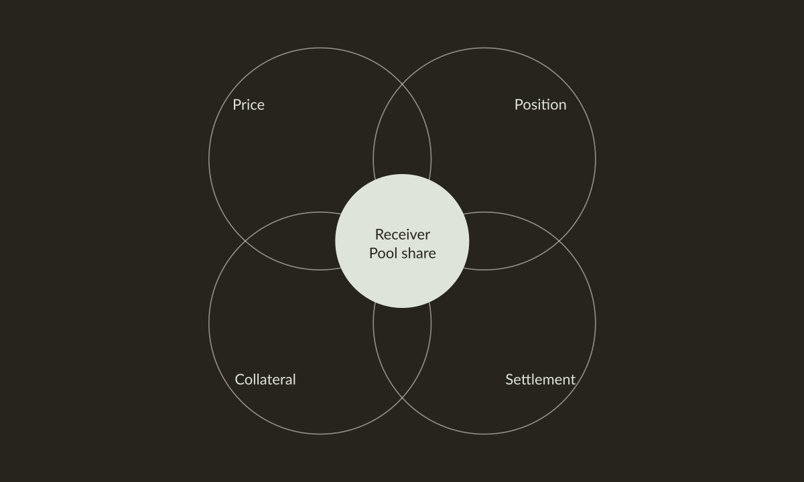

When you join the Receiver side of a market, you get a Receiver Pool share. It is an ordinary token, and it follows the asset's price. Most DeFi products need four things: a price, a position, collateral and a way to settle. A synthetic is all four in one token. That is what makes it a building block.

<Frame>
  
  
</Frame>

## Why it's a better block

| Quality | What it means |
| --- | --- |
| Just a token | Works in any wallet, exchange or lending market. |
| No spread | In and out at the oracle price. Entry and exit fees apply. |
| No funding to pay | You give up your deposit's interest instead of paying funding on the whole position. |
| Fully backed | Every position is backed by deposits. No margin calls on a direct position. |
| Fixed rules | Open contracts on Ethereum. A market's rules are set when it is created. |
| Reviewed | The core contracts were audited by Nethermind in August 2026. See [Audits](/protocol/audits) for what that review covered. |

## What you can build with it

| Product | Built from | Why it's better |
| --- | --- | --- |
| A tokenised stocks app | Receiver share | Hold a stock or index price in your own wallet. No broker, no custodian, no spread. |
| A 24/7 stock exchange | Receiver share + Uniswap | Shares trade in Uniswap pools around the clock. No closing bell, no weekend gap. |
| A perps-like trading venue | Receiver share + Morpho | Leveraged long and short trading. Cheaper: USDC borrow rates usually run below perp DEX funding. |
| A stock-backed lending market | Receiver share + Morpho | Borrow against your shares without selling. You keep your upside. |
| A market-making desk | Payer share + a hedge | Back markets, earn both pools' interest and hedge elsewhere. Returns come from interest, not direction. |
| A two-layer savings account | Collateral Vault + Savings Vault | One deposit earns vault interest plus Morpho loan interest. Two sources instead of one. |
| A curated RWA vault | Receiver shares + a vault | An index or model portfolio of markets in one token. Diversified, and as easy to move as any token. |
| A neobank for the world's markets | Any block + your app | A simple app on top, open settlement underneath. Web2 ease, without trusting a custodian. |

Null's own app starts with the most useful one: lending and borrowing synthetics on Morpho. Next: [Synthetics go on Morpho](/concepts/morpho-markets).
