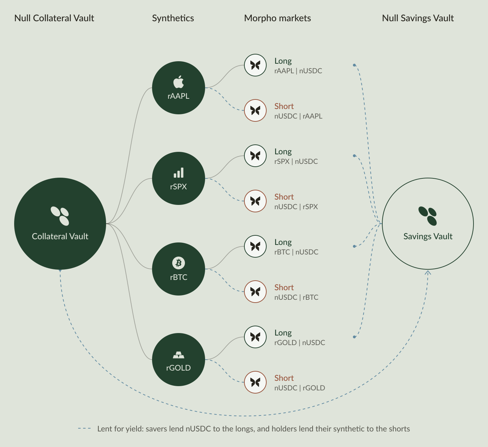
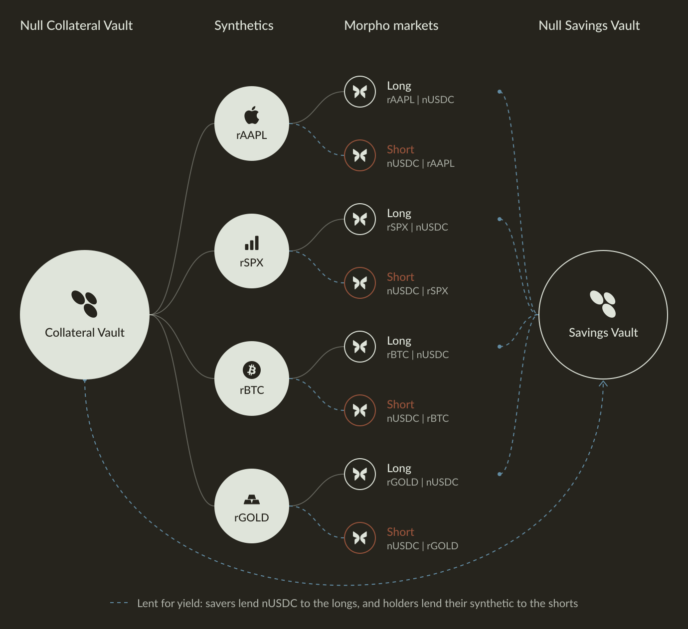

Null is built in four layers. Each one uses the layer below it, so you can understand the whole system by reading from the bottom up. The rest of this section does exactly that, one page per layer.

<Frame caption="Synthetics shown are examples. The live list is on /trade.">
  
  
</Frame>

## The four layers

| Layer | In one line | Read |
| --- | --- | --- |
| Collateral Vault | Your USDC becomes nUSDC, which earns interest and backs every market. | [Collateral Vault](/concepts/collateral-vault) |
| Synthetics | Each market splits nUSDC into two pools. The Receiver side is a token that follows a price, such as rAAPL. | [Two pools](/concepts/the-primitive), [How Payers earn](/concepts/funding-and-yield), [Synthetics](/concepts/building-block) |
| Long and short markets | Every synthetic gets two Morpho markets, one to borrow nUSDC against it and one to borrow it. | [Long and short markets](/concepts/morpho-markets) |
| Savings Vault | Savers' nUSDC is lent into the long markets, for a second layer of interest. | [Savings Vault](/concepts/savings-vault) |

## Where each product sits

Every action in the app happens on one of these layers.

| Action | Layer | See |
| --- | --- | --- |
| **Save** | Savings Vault | [Savings](/products/savings) |
| **Hold** a price | Synthetics | [Spot](/products/spot) |
| **Back** a market | Synthetics, the Payer side | [Payers](/market-making/overview) |
| **Lend** nUSDC or a synthetic | Long and short markets | [Lending](/products/lending) |
| **Leverage** long or short | Long and short markets | [Margin](/products/margin) |

That is why we call it the everything app. One vault and one kind of token are enough to rebuild saving, holding, lending and leverage, with open settlement underneath.

Start at the bottom: [Collateral Vault](/concepts/collateral-vault).
