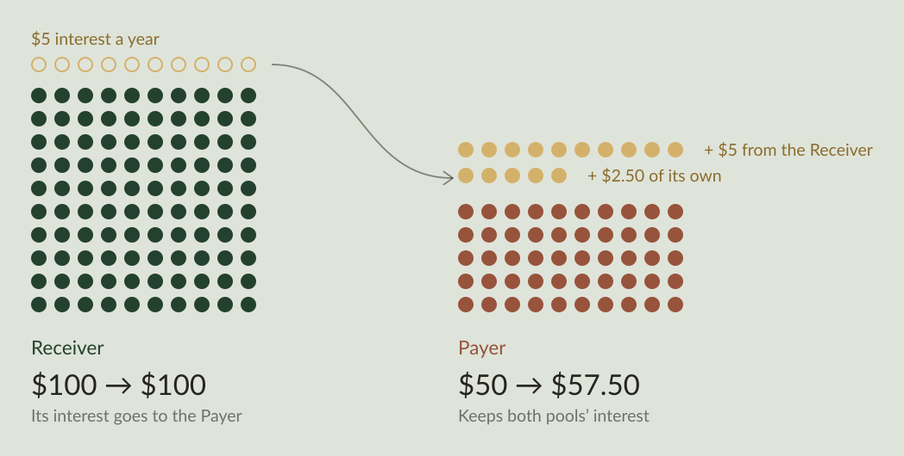
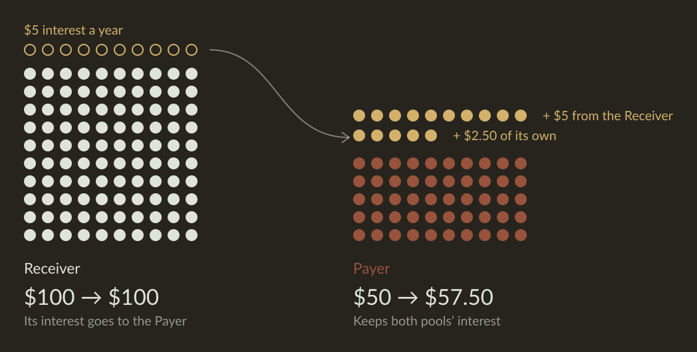

Both pools hold nUSDC, and nUSDC earns interest in the [Collateral Vault](/concepts/collateral-vault). Receivers hand their share of that interest to Payers. That is what following the price costs a Receiver, and what a Payer is paid for taking the opposite side.

The app calls this transfer **funding**. On Null it only ever flows one way, from Receivers to Payers, because its source is interest that has already been earned.

## A worked example

Take the $100 Receiver and $50 Payer from [Two pools](/concepts/the-primitive), with the vault earning 5% a year. The Receiver's interest goes to the Payer, on top of the Payer's own.

<Frame caption="Each dot is $1, each small dot 50¢. 5% a year. Price moves and fees not included.">
  
  
</Frame>

| | Exposure | Deposit | Interest kept, at 5% a year |
| --- | --- | --- | --- |
| Receiver | $100 | $100 | $0. It goes to the Payer. |
| Payer | $100, the other side | $50 | $7.50, which is 7.5% of the exposure it backs |

The Payer keeps the interest on both deposits: $2.50 on its own $50 and $5 from the Receiver's $100. Measured against the $50 it put in, that is 15% a year before any price move.

This is an example only. Rates change, Payers share the interest between them, and price moves and fees are not included.

## Why this beats paying funding

On a perpetual future, you pay funding on your whole position, and the rate can swing against you. On Null, a Receiver pays nothing out of pocket. You only give up the interest your own deposit would have earned.

## The rule for Payers

For a Payer, the interest works out at roughly:

```text
carry ≈ y × (1 + R / P)
```

`y` is the vault's interest rate. The `1` is your own deposit earning. The `R / P` part is the Receivers' interest, spread across the Payer pool. When Receivers outnumber Payers, each Payer earns more, and carries more price risk. [Payers](/market-making/overview) goes deeper.

## The rates in the app

| Rate | What it means |
| --- | --- |
| **Collateral APR** | What the Null Collateral Vault is earning right now. |
| **Funding APR** | That interest, as paid from the Receiver pool to Payers. |
| **Net APR** | The total for the side you hold. For a Payer it is scaled by `R / P`. It describes current rates, not a promise. |
| **AER** | The Savings rate. It comes from the Null Savings Vault lending into long markets, not from funding. |

## Rules that keep it simple

| Rule | What it does |
| --- | --- |
| Only real interest | Funding pays out interest the vault has actually earned, measured against its previous high. |
| Never negative | If the vault has a bad stretch, funding pauses until it recovers. Payers never pay Receivers. |
| Capped | A single interval cannot pass across more than a 100% annual rate. Anything above stays with Receivers. |
| Tiny pools skip | If either pool is at its minimum size, that interval's interest is not charged later. |

Never negative describes the transfer, not your position. If the vault loses value, the collateral in both pools falls with it.

## What funding is not

Funding is not a fee. It stays inside the market and moves between its two pools. Null does not take it as revenue. Entry and exit fees are separate, see [Fees](/concepts/fees).

If you hedge a Payer position somewhere else, that hedge has its own funding, fees and margin. Judge the two together. The contract detail is in [Funding rate model](/protocol/funding-rate-model).

Next: [Synthetics](/concepts/building-block), the Receiver side of a market as a token you can use anywhere.
