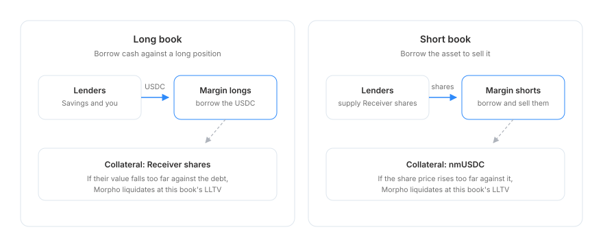
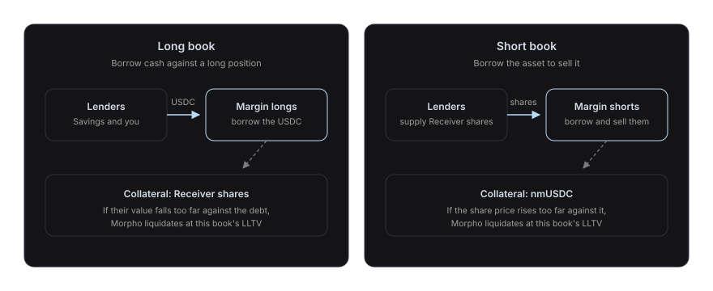

[Lending](/products/lending) and [Margin](/products/margin) use **Morpho Blue**. Spot does not. A Spot Receiver or Payer position stays inside the Null pools and is not liquidated by Morpho.

For a Null market that is fully wired, there are two Blue books.

<Frame>
  
  
</Frame>

| Book | Loan | Collateral | Who uses it |
| --- | --- | --- | --- |
| **Long** | USDC | Receiver pool share | Margin longs borrow USDC. Savings and lenders supply USDC. |
| **Short** | Receiver pool share | Collateral vault share (`nmUSDC`) | Margin shorts borrow Receiver shares. Lenders supply those shares. |

Each book has its own oracle, interest-rate model, and **LLTV** (liquidation loan-to-value). Morpho can liquidate a position when its loan-to-value reaches that book's LLTV.

## Long

A Margin **Long** posts USDC equity and ends up with leveraged Receiver exposure and USDC debt:

1. You post USDC equity.
2. The router borrows the rest of the USDC from the long book.
3. It wraps to `nmUSDC`, buys Receiver shares, and posts those shares as Morpho collateral.
4. The USDC borrow repays the temporary borrow.

Closing repays the debt, withdraws the Receiver shares, sells them, and returns leftover USDC.

Idle USDC on the long book is what new longs borrow. Thin free USDC can block a large long or a large Savings withdrawal.

## Short

A Margin **Short** posts USDC equity, wraps it to `nmUSDC`, and borrows Receiver shares against that collateral. The router sells those shares in the Receiver pool. You end with negative Receiver exposure and share debt.

Closing buys just enough Receiver shares to repay the debt. It does not depend on spare lender liquidity in the short book.

## Liquidation

Spot has no liquidation price. Margin does, because the debt sits on Morpho.

Open at leverage `L` means opening loan-to-value `1 - 1/L`. Liquidation happens when loan-to-value reaches the book's LLTV. The adverse price move that gets you there, before interest, is:

```text
drop to liquidation = 1 - (1 - 1/L) / LLTV
```

The app shows this as **Liquidation price** on the ticket and as **Liq. price** on open positions. Live LLTV and the slider ceiling are on the Margin **Parameters** tab. The slider stays under the theoretical maximum `1 / (1 - LLTV)`.

A perpetual with maintenance margin `mm` liquidates a long after:

```text
drop = (1/L - mm) / (1 - mm)
```

Matching that distance means choosing an LLTV, not changing the Null pools. Maintenance margin of 5% lines up with LLTV of 95%. Higher leverage targets need a higher LLTV. Read the live LLTV in the app before you size a position.

## What is liquidated

Only the Morpho position is liquidated, and only on the book it borrowed from. A Spot holder who never opened Margin is not liquidated by Morpho. A lender who only supplied assets is not liquidated either. The lender can still lose money if borrowers default and collateral does not cover the loan.

Contract detail: [Morpho integration](/protocol/morpho-integration).
