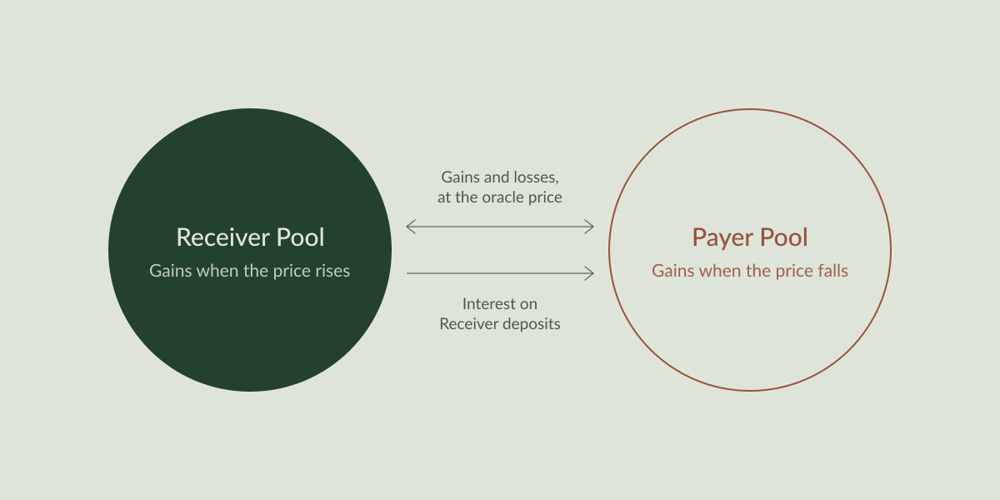
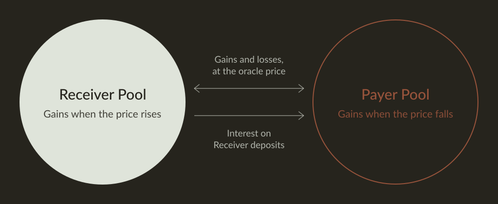
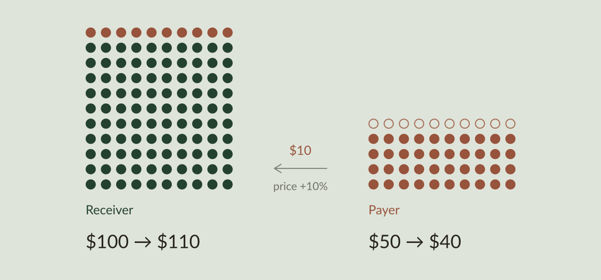
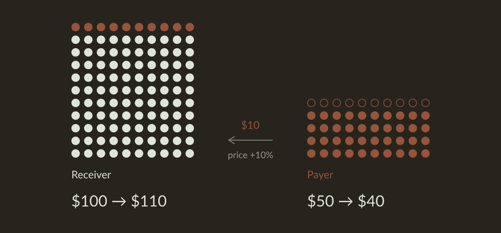

This is the second layer. A market takes nUSDC from the [Collateral Vault](/concepts/collateral-vault) and splits it into two pools. Receivers get the price return of an asset, such as the S&P 500, without owning it. Payers take the opposite side. When the price rises, Payers pay Receivers. When it falls, Receivers pay Payers.

<Frame>
  
  
</Frame>

Both pools hold nUSDC. When the price moves, the market moves collateral from one pool to the other. Nobody borrows the asset and nobody holds it for you.

## The two sides

| Side | What you do | What you get |
| --- | --- | --- |
| Receiver | Follow the price. You deposit USDC and get a Receiver Pool share. Its value rises and falls with the asset. | Price exposure with no borrowing, so no margin calls. In return, the interest your deposit earns goes to Payers, and so do your opening and closing fees. |
| Payer | Take the opposite side. You deposit USDC and gain when the price falls, lose when it rises. | The interest on your own deposit and on the Receivers' deposits, plus the fees Receivers pay to open and close. Many Payers hedge the price elsewhere. Returns are not fixed. |

You never own the asset. A Receiver Pool share is a claim on collateral in the pool, not a share of Apple or a bar of gold. There are no votes or dividends, unless the price feed itself includes them.

## A price move, end to end

A Receiver deposits $100. A Payer deposits $50 to back it. The asset rises 10%, so $10 moves from the Payer pool to the Receiver pool. The Receiver now has $110 and the Payer $40.

<Frame caption="Each dot is $1. Fees not included.">
  
  
</Frame>

If the asset falls, money moves the other way. A Receiver can never gain more than the Payers have deposited.

## How a market runs

| Part | How it works |
| --- | --- |
| Prices | Chainlink price feeds. The market reads a fresh price before every deposit and withdrawal. |
| Settlement | Gains and losses move between the pools at that price, then your trade goes through. |
| Backing | Every position is fully backed. Settlement only moves collateral that is already in the pools, so nobody can end up owing money. |
| Fees | Receivers pay an opening and closing fee, and it goes to the Payer pool, not to Null. Payers' own fees go to the Receiver pool. See [What it costs](/concepts/fees). |
| If Payers run out | Returns stop until new Payers join. Missed price moves are not made up later. |
| Big jumps | A single move of more than 20% is skipped, not settled. The new price becomes the starting point. |
| Rules | Each market's collateral, price feed and funding model are fixed when it is created. |

## Why Payer moves faster than the price

A Payer backs the whole Receiver pool with a smaller deposit. In the example, $50 backs $100 of exposure, so each Payer dollar carries two dollars of the other side. The ratio is `R / P`: Receiver pool assets divided by Payer pool assets.

That ratio works both ways. It makes a Payer's share of the interest bigger, and it makes price moves hit harder. It also changes as people join and leave either pool. [Payers](/market-making/overview) covers how to size and hedge it.

## Next

Next: [Payers earn the interest](/concepts/funding-and-yield), where the interest on all that nUSDC goes.
