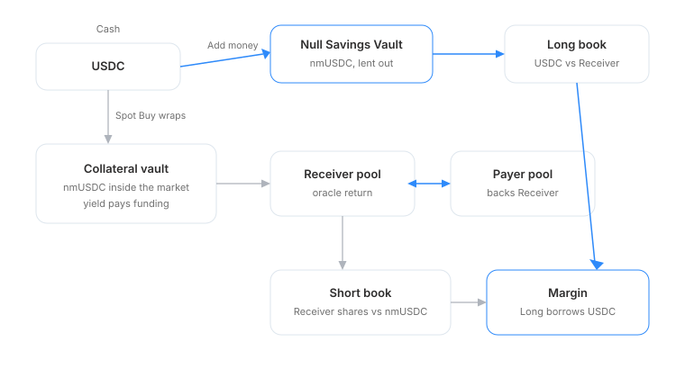
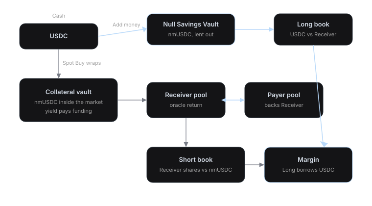

Null uses a Morpho Vault V2 share in two roles. The share is the same token. The role depends on what you do with it.

| Role | What you hold | What it does |
| --- | --- | --- |
| **Collateral vault** | The market's collateral token, `nmUSDC` | Backs Receiver and Payer. Earns Morpho lending yield. That yield is the source of [funding](/concepts/funding-and-yield). |
| **Null Savings Vault** | The same vault, shown in the app as **Null Savings Vault** | Takes a USDC deposit from **Cash** and allocates it to Morpho long books. |

Spot markets hold vault shares inside the pools. Savings is how you deposit the underlying USDC into the vault without opening a Receiver or Payer position.

<Frame>
  
  
</Frame>

## Collateral vault

Every Null market is created with one ERC-20 collateral token. On the current stack that token is a Morpho Vault V2 share whose underlying is USDC.

- Both pools account in vault-share units.
- When Morpho borrowers pay interest, vault share value rises.
- Settlement reconciles that growth across Receiver and Payer.
- Receivers pay that yield on the Receiver pool to Payers as funding.

## Null Savings Vault

In the app, **Savings** is USDC you deposit into the vault. You receive vault shares. Interest accrues into share value. It is not paid as a separate transfer.

The vault does not deposit into Null Receiver pools. It allocates USDC into Morpho Blue **long** books:

- **Loan token:** USDC
- **Collateral token:** that market's Receiver pool share

Those are the same books leveraged longs borrow from. Savings earns the Morpho supply rate. The Savings card shows that rate as an annual equivalent rate (AER), to two decimal places.

Most of the vault is lent out. A large withdrawal needs free USDC. If free liquidity is short, withdraw a smaller amount or wait.

```text
USDC (Cash)
   │
   ├─ Savings: Add money ──► Morpho Vault V2 (nmUSDC)
   │                            └─ lends USDC on Morpho long books
   │                               (Receiver shares are borrower collateral)
   │
   └─ Spot Buy ──► wrap to nmUSDC ──► Receiver or Payer pool
```

- **Savings** earns Morpho lend yield from borrowers on the long books.
- **Spot** holds `nmUSDC` in Null pools and tracks the oracle asset.
- **Margin longs** borrow the USDC that Savings and other lenders supply.

See [Morpho markets](/concepts/morpho-markets) and [Savings](/products/savings).
