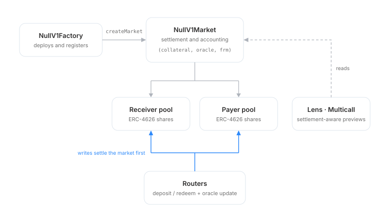
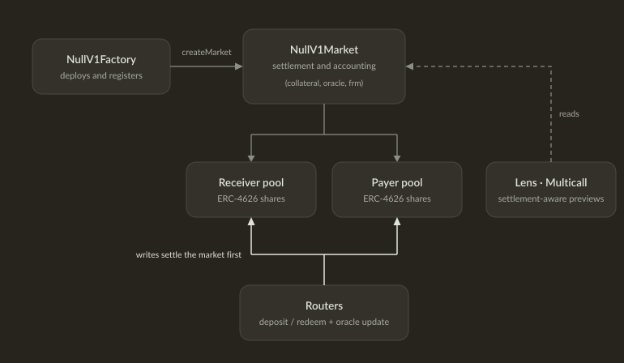

Null V1 is a **contracts-first** protocol. Integrators discover markets, read state, and deposit or redeem through Solidity interfaces, typically via `viem`, `ethers`, or a wallet SDK. There is no published Null npm SDK and no partner trading API with API keys.

These integration guides target **Ethereum mainnet**. Copy addresses only from [Deployments](/developers/addresses). If a constant is not listed there yet, treat it as unknown.

<Note>
The app uses Buy / Sell for Spot deposit and redeem flows. Onchain and in these docs, use ERC-4626 `deposit` / `redeem` (and router `depositMarket` / `redeemMarket`).
</Note>

## What you are integrating

A Null market is a fully collateralized pooled total-return swap. Users deposit collateral into one or both of two ERC-4626 pools:

| Side | Role |
| --- | --- |
| **Receiver** | Synthetic long on the oracle-tracked price |
| **Payer** | Negative-size position in the Receiver pool. Takes the opposite price exposure and receives funding paid from collateral yield |

Spot has no Null-native loans or liquidations. Settlement redistributes collateral the market already holds. Leveraged positions are separate periphery. See [Morpho integration](/protocol/morpho-integration).

A market is uniquely identified by an immutable tuple:

```text
(collateral, oracle, frm)
```

- `collateral`: ERC-20 held by the market (may itself be an ERC-4626 vault share)
- `oracle`: price source, always scaled to `1e36`
- `frm`: funding-rate model (must be factory-enabled)

For market-level metrics, let `R` be Receiver pool assets and `P` be Payer pool assets:

- **Coverage** is `P/R`: backing relative to Receiver assets.
- A **Payer** is a negative-size position in the Receiver pool, with the market's collateral held inside that structure. The magnitude of that short relative to Payer capital is `R/P` at the current market state (inverse of coverage).

Handle a zero denominator explicitly. Neither ratio is defined when its denominator is zero.
`R/P` is not a funding rate. Funding is vault yield on the Receiver pool, paid to Payers. See [Funding-rate model](/protocol/funding-rate-model).

## Architecture

<CardGroup cols={2}>
  <Card title="Core" icon="boxes">
    `NullV1Factory` deploys and registers markets.

    `NullV1Market` owns accounting and settlement.

    `NullV1Pool` (×2) exposes Receiver and Payer ERC-4626 shares.
  </Card>
  <Card title="Periphery" icon="route">
    `NullV1Router` wraps create, deposit, redeem, deadlines, slippage, and Chainlink `updateData`. `NullV1MorphoRouter` opens and closes Margin.

    `NullV1Lens` / `NullV1Multicall` provide read-only previews and batch simulation.
  </Card>
</CardGroup>

<Frame>
  
  
</Frame>

Most integrations need three rules:

1. Resolve the market with `factory.getMarket(collateral, oracle, frm)` (or index `CreateMarket`).
2. Enter and exit through a pool or through the matching router.
3. Every state-changing pool action **settles the market first**, so previews can diverge from execution.

## Surfaces at a glance

### Factory

```solidity
function getMarket(address collateral, address oracle, address frm)
    external view returns (address market);

function createMarket(
    IERC20 collateral,
    INullV1Oracle oracle,
    INullV1FundingRateModel frm
) external returns (INullV1Market market);
```

### Market

```solidity
function receiverPool() external view returns (INullV1Pool);
function payerPool() external view returns (INullV1Pool);
function state() external view returns (
    uint256 lastUpdate,
    uint256 receiverPoolAssets,
    uint256 payerPoolAssets,
    uint256 protocolFees,
    uint256 price
);
```

Pools call `updateState()`. External integrators normally do not.

### Pools

Standard ERC-4626 entry points on each side:

```solidity
deposit / redeem
previewDeposit / previewRedeem

`mint` and `withdraw` revert. Use `deposit` and `redeem`.
```

### Router

Protected combined flows:

```solidity
depositMarket(market, receiverAssets, payerAssets, minReceiverShares, minPayerShares, deadline, updateData)
redeemMarket(market, receiverShares, payerShares, minReceiverAssets, minPayerAssets, deadline, updateData)
```

Use `NullV1Router` for Chainlink updates. Do not attach `msg.value`. Margin writes go through [NullV1MorphoRouter](/developers/morpho-router).

## What is not available

| Expectation | Reality |
| --- | --- |
| Published Null SDK | Use ABIs + `viem` / `ethers` against the contracts |
| Public partner REST API / webhooks | Reads are onchain (Lens) or your own indexer; the product indexer is not a keyed public API |
| Ethereum deployment constants | Copy them from [Deployments](/developers/addresses); do not guess |
| Order book / MM credentials | Markets are pooled deposit and redeem, not a central limit order book |

## Recommended path

<Steps>
  <Step title="Understand the payoff">
    Read [Protocol overview](/protocol/overview), then [Funding-rate model](/protocol/funding-rate-model). Use [Risks](/concepts/risks) for the limits.
  </Step>
  <Step title="Build the first transaction">
    Follow the [Quickstart](/developers/quickstart). It resolves a market, reads both pools, previews a deposit, and submits router calls.
  </Step>
  <Step title="Learn execution details">
    Read [Settlement](/protocol/settlement), [Depositing](/developers/depositing), [Redeeming](/developers/redeeming), and [Oracles](/markets/oracles).
  </Step>
  <Step title="Prepare for production">
    Add the [Router](/developers/router), then build a [Frontend](/contracts/integration/ui) or [Indexer](/contracts/integration/indexer). Revisit [Audits](/protocol/audits) and [Risks](/concepts/risks) before shipping.
  </Step>
</Steps>
