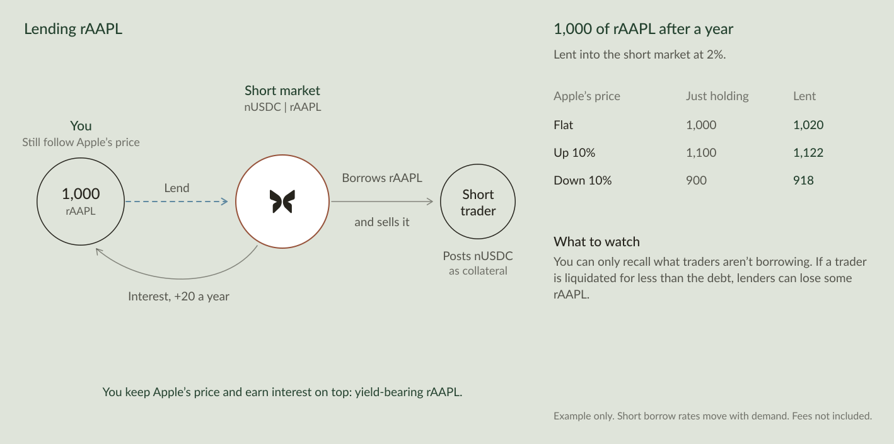
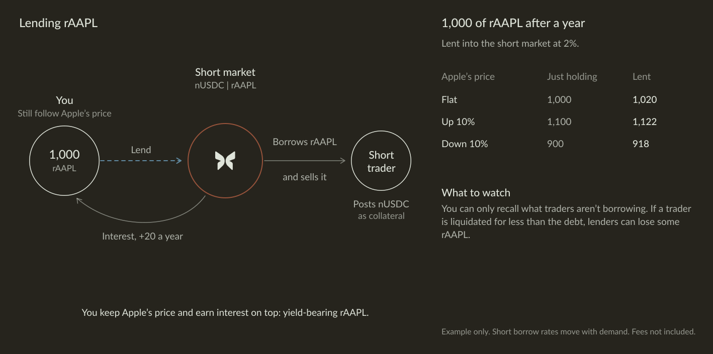

Savers lend nUSDC to the longs. The short markets need something different: the synthetic itself. That comes from people who already hold it. If you hold rAAPL, you can lend it into its short market, earn interest, and still follow Apple's price the whole time.

<Frame caption="Each figure is an example. Rates change.">
  
  
</Frame>

## How it works

| | |
| --- | --- |
| What you lend | A synthetic you hold, such as rAAPL. |
| Where it goes | Its short market, `nUSDC \| rAAPL`. |
| Who borrows it | Leverage Short traders. They post nUSDC as collateral, borrow rAAPL and sell it. |
| What you earn | The short borrow rate, paid in rAAPL. It rises when more traders want to short. |
| What you keep | rAAPL's price exposure. Your balance still rises and falls with Apple. |

## Why it matters

| For | What it does |
| --- | --- |
| Holders | Turns a plain price position into one that also earns interest. rAAPL becomes yield-bearing. |
| Short traders | Makes shorting possible. A Leverage Short can only borrow what holders have lent. |
| The system | Balances the top layer. Savers fund the longs, holders fund the shorts, and both are paid by the traders who use them. |

## How you do it

Lend from the lending book at `/lending`: pick the synthetic's short market, select **Lend** and confirm. Take it back with **Recall**. See [Lending](/products/lending) for the full walkthrough.

## What to watch

| Risk | What it means for you |
| --- | --- |
| Price | Lending doesn't remove price risk. If Apple falls, your rAAPL falls with it. |
| Recalls | You can only recall what traders aren't borrowing. In a busy market, you may wait for loans to be repaid. |
| Bad debt | If a short trader is liquidated for less than the debt, lenders can lose some of what they lent. |
| The rate moves | When few people want to short, the rate can be close to zero. |

That completes the four layers. [Null is four layers](/how-null-works/null-is-four-layers) shows them together. Then: [What it costs](/how-null-works/what-it-costs) and [What can go wrong](/how-null-works/what-can-go-wrong).
