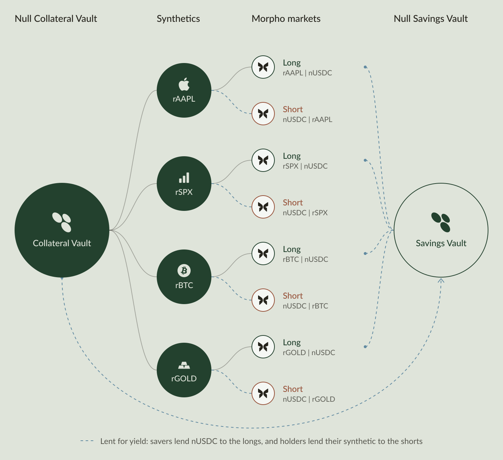
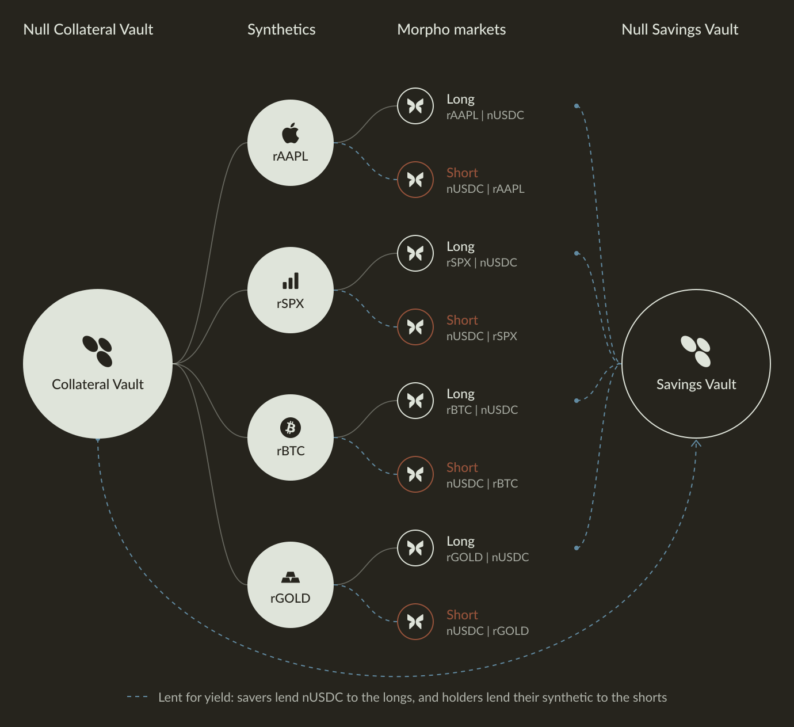

Null is built in four layers. Each one uses the layer below it, so you can understand the whole system by reading from the bottom up. The rest of this section does exactly that, one page per layer.

<Frame caption="Synthetics shown are examples. The live list is on /trade.">
  
  
</Frame>

## The four layers

| Layer | In one line | Read |
| --- | --- | --- |
| Collateral Vault | USDC becomes USDCn, which earns interest and backs every market. | [USDC becomes USDCn](/how-null-works/usdc-becomes-usdcn) |
| Synthetics | Each market splits USDCn into two pools. The Receiver side is a token that follows a price, such as AAPLr. | [USDCn backs two pools](/how-null-works/usdcn-backs-two-pools), [Payers earn interest and fees](/how-null-works/payers-earn-interest-and-fees), [Receivers hold synthetics](/how-null-works/receivers-hold-synthetics) |
| Long and short markets | Every synthetic gets two Morpho markets, one to borrow USDCn against it and one to borrow it. | [Synthetics go on Morpho](/how-null-works/synthetics-go-on-morpho) |
| Lenders | Savers' USDCn is lent into the long markets. Holders lend their synthetics into the short markets. | [Savers lend to longs](/how-null-works/savers-lend-to-longs), [Holders lend to shorts](/how-null-works/holders-lend-to-shorts) |

## Where each product sits

Every action in the app happens on one of these layers.

| Action | Layer | See |
| --- | --- | --- |
| **Save** | Savings Vault | [Savings](/products/savings) |
| **Hold** a price | Synthetics | [Spot](/products/spot) |
| **Back** a market | Synthetics, the Payer side | [Payers](/payers) |
| **Lend** USDCn or a synthetic | Long and short markets | [Lending](/products/lending) |
| **Leverage** long or short | Long and short markets | [Margin](/products/margin) |

That is why we call it the everything app. One vault and one kind of token are enough to rebuild saving, holding, lending and leverage, with open settlement underneath.

Start at the bottom: [USDC becomes USDCn](/how-null-works/usdc-becomes-usdcn).
