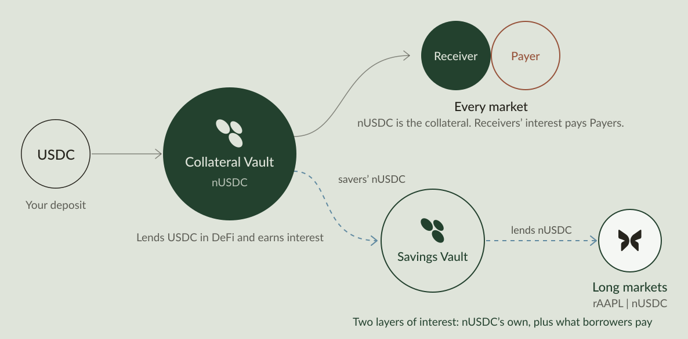
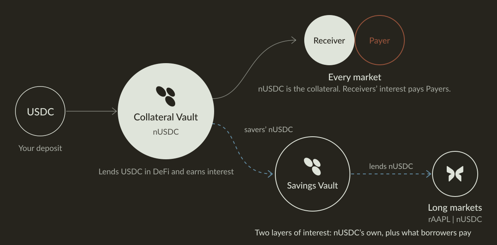

The Null Savings Vault sits on top of everything else. It takes nUSDC from savers and lends it into the long market of every synthetic. Savers earn twice: once from the Collateral Vault, and again from the borrowers.

<Frame>
  
  
</Frame>

## What it is

| | |
| --- | --- |
| The vault | A Morpho vault whose asset is nUSDC. |
| Where it lends | The long market of every synthetic, such as `AAPLr \| nUSDC`, where Leverage Long traders borrow. |
| What you earn | The interest nUSDC already earns, plus the interest borrowers pay. The app shows the total as **AER**. |
| How you use it | **Add money** and **Withdraw**, under **Home** and then **Save**. See [Savings](/products/savings). |

It never lends to the short markets. Those lend synthetics, which come from holders. See [Holders lend to shorts](/how-null-works/holders-lend-to-shorts).

## Lent money is not idle money

Most of what the vault holds is out on loan at any moment. That is how it earns. A small withdrawal is usually met from what is free. A large one may need to wait for borrowers to repay, or be taken in parts. That free nUSDC is also what new Leverage Long trades borrow, so when it runs thin, both get harder.

## What to watch

| Risk | What it means for you |
| --- | --- |
| Collateral Vault | Savings holds nUSDC, so it falls if the Collateral Vault loses value. |
| Borrowers | If a long-market borrower is liquidated for less than the debt, lenders can lose principal. |
| Curation | Which markets the vault lends to, and how much, is set by its curator. |
| Liquidity | Savings suits money you don't need on a precise timetable. |

Next: [Holders lend to shorts](/how-null-works/holders-lend-to-shorts), the other half of the top layer.
