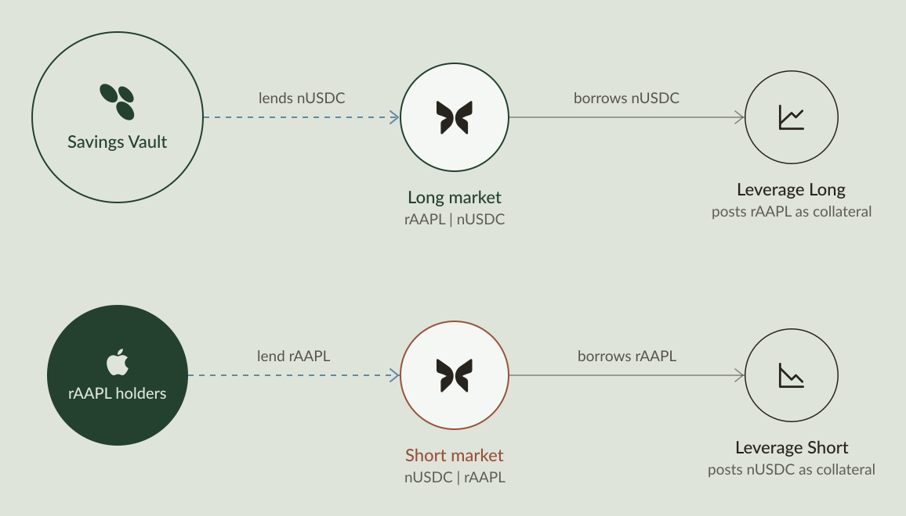
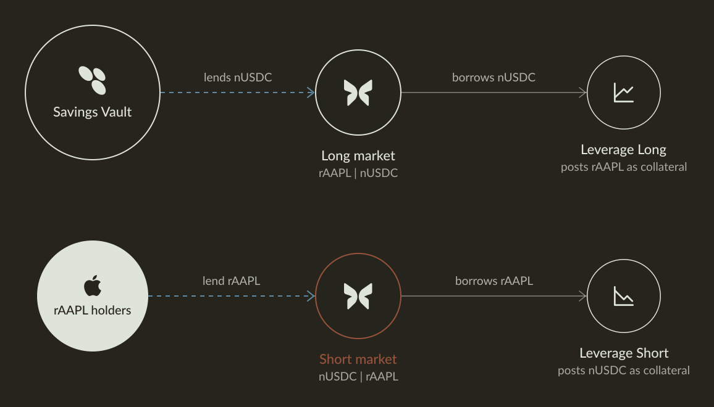

This is the third layer. Every synthetic gets two Morpho lending markets: one for going long, one for going short. They are where leverage comes from, and where nUSDC and synthetics can be lent for interest.

<Frame>
  
  
</Frame>

Markets are written collateral first, then the asset being lent.

## The long market

| | |
| --- | --- |
| Written as | `rAAPL \| nUSDC` |
| Who lends | The [Savings Vault](/how-null-works/savers-lend-to-longs), and anyone lending nUSDC through **Lend**. |
| Who borrows | Leverage Long traders. They post rAAPL and borrow nUSDC to buy more of it. |
| Lenders earn | The interest borrowers pay, on top of what nUSDC already earns in the Collateral Vault. |

## The short market

| | |
| --- | --- |
| Written as | `nUSDC \| rAAPL` |
| Who lends | rAAPL holders, through **Lend**. |
| Who borrows | Leverage Short traders. They post nUSDC, borrow rAAPL and sell it. |
| Lenders earn | Interest on their rAAPL, while they keep its price exposure. |

That last line matters. Lending your synthetic into its short market turns a plain price position into one that also earns interest. A Leverage Short is only possible because someone was willing to lend.

## Each market has its own settings

Every Morpho market has its own price feed and its own interest rate model, so two markets can behave differently at the same moment. Null markets use a 96.5% LLTV, the loan-to-value at which a borrower can be liquidated. Read the live terms on **Parameters** before you trade.

## When a borrower is liquidated

Opening at leverage `L` starts your loan-to-value at `1 - 1/L`. It rises when the price moves against you or as interest adds to the debt. When it reaches the 96.5% LLTV, Morpho can liquidate the position.

Before interest, the price drop that takes a new long to that point is:

```text
drop to liquidation = 1 - (1 - 1/L) / LLTV
```

Only the borrower is liquidated, and only in the market they borrowed from. Spot holders and lenders have no loan to liquidate. Lenders carry a different risk: if a borrower is liquidated for less than the debt, lender principal can be lost.

## Lent money is not idle money

You can only take back what borrowers are not using. If most of a market is lent out, a **Recall** or a Savings withdrawal may have to wait for repayments. Compare **Total Liquidity** with **Outstanding Loans** before you lend.

Next: [Savers lend to longs](/how-null-works/savers-lend-to-longs). For the contract level view, see [Morpho integration](/protocol/morpho-integration).
