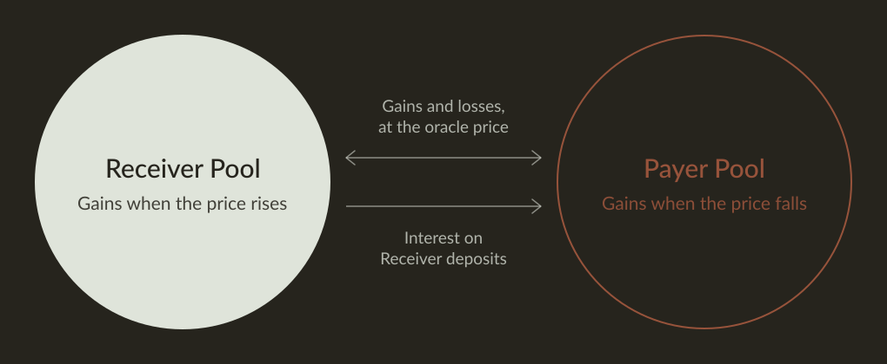

Null runs in open contracts on Ethereum. There is no broker, no custodian and no margin account. You keep your tokens in your own wallet, and every position is fully backed.

## Every market has two pools

Receivers get the price return of an asset, such as Apple or the S&P 500, without owning it. Payers take the opposite side. When the price rises, Payers pay Receivers. When it falls, Receivers pay Payers.

<Frame>
  
  
</Frame>

That is the whole idea. Everything else in Null is built on it. [nUSDC backs two pools](/concepts/the-primitive) walks through it with a worked example.

## What you can do with it

| You want to | Use | What happens |
| --- | --- | --- |
| Earn on your USDC | [Savings](/products/savings) | Your deposit is lent to the long markets for interest. |
| Hold a price | [Spot](/products/spot) | You buy a token that follows a stock, index, commodity or coin. |
| Earn on what you hold | [Lending](/products/lending) | You lend nUSDC to longs, or your synthetic to shorts. |
| Take a bigger position | [Margin](/products/margin) | You borrow on Morpho to go long or short. |
| Back the market | [Payers](/market-making/overview) | You take the other side and earn both pools' interest. |

These are all one app. [Null is four layers](/concepts/everything-app) shows how the pieces stack: one curated vault, many synthetics, a long and a short market for each, and a savings vault that lends into them.

## Where to start

<CardGroup cols={2}>
  <Card title="Null is four layers" icon="layers" href="/concepts/everything-app">
    How the four layers fit together.
  </Card>
  <Card title="nUSDC backs two pools" icon="circle-dot" href="/concepts/the-primitive">
    The one idea behind every market.
  </Card>
  <Card title="Fund your account" icon="wallet" href="/get-started/fund-your-account">
    Connect your wallet and add USDC.
  </Card>
  <Card title="What can go wrong" icon="shield-alert" href="/concepts/risks">
    What can go wrong, in plain terms.
  </Card>
</CardGroup>

<Note>
Prices come from Chainlink oracles, and markets settle when someone uses them. A value on screen is the last settled state, not a live quote. Positions can lose value, leveraged ones can be wiped out, and Null is not offered in the United Kingdom. Read [Risks](/concepts/risks) before you start.
</Note>
