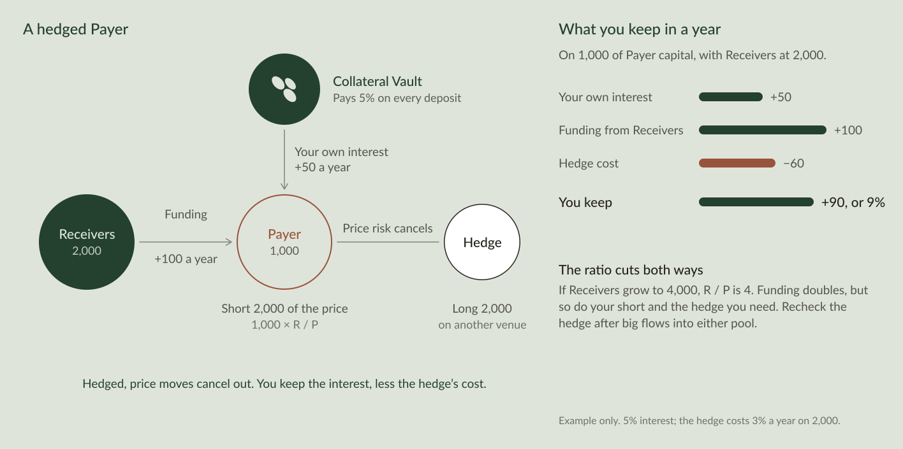
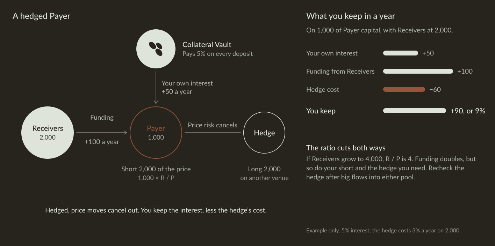

A Payer backs the Receivers in a market. When the price rises, Payers pay Receivers. When it falls, Receivers pay Payers. For taking that side, Payers earn the interest on their own deposit and on the Receivers' deposits.

That trade should be understood before it is admired. Payer pays you to carry risk. It does not remove the risk. Your returns come from interest rather than direction only if you hedge the price away.

<Frame>
  
  
</Frame>

To see Payer in the app, turn on **Pro Mode** in the account menu. Spot then offers **Payer buy** and **Payer sell**.

## What you hold

A Payer position is long the collateral and short the price at the same time. How short is not a setting you choose. It comes from the balance of the two pools:

```text
short scale = R / P
Payer short notional = p × R / P
```

`R` is the Receiver pool's assets and `P` the Payer pool's, both in nUSDC. `p` is your Payer position's value. If the Receiver pool is three times the Payer pool, each Payer dollar carries about three dollars of short exposure. When Payers are scarce, the same position becomes a bigger bet without you adding anything.

## What you earn

| Source | What it is |
| --- | --- |
| Your own interest | Your deposit earns in the Null Collateral Vault, like any nUSDC. |
| Funding | The Receivers' interest, paid across to the Payer pool. |

Together, before fees and hedge costs:

```text
carry ≈ y × (1 + R / P)
```

`y` is the vault's interest rate. With 5% interest and Receivers twice the size of Payers, carry is about 15% a year on your Payer capital. Thin coverage raises your interest and your exposure at the same time. [How Payers earn](/how-null-works/payers-earn-interest-and-fees) has the worked example.

## Hedging is your job

Most Payers don't want the price risk, so they hedge outside Null, by buying the asset or a perp on it elsewhere. What's left is the trade they wanted: Null funding plus collateral interest, minus the cost of the hedge.

Null doesn't open, size or manage that hedge. The other venue charges its own funding, fees and margin, none of which show in Null's **Funding APR**. A rate that looks generous here can still lose money once the hedge costs turn against you. Judge both legs together.

The hedge should match your short notional, `p × R / P`, and that drifts as the pools change. Recheck it after large flows into either pool.

## Receiver fees pay for your rehedging

Your hedge has to follow the Receiver pool. Every time a Receiver buys, your short grows and you buy more hedge. Every time a Receiver sells, your short shrinks and you sell hedge. Price moves alone don't change how many units you are short, so the rehedging is driven by flows, and each new unit of short opens at the current oracle price.

That rehedging costs you spread and execution. Receivers pay an entry fee and an exit fee on the notional they trade, and on the standard deployment those fees go to the Payer pool. The fee is charged on exactly the volume you have to rehedge, so it grows one for one with the work it pays for.

Say the Payer pool holds 5,000 and the Receiver pool 15,000, so Payers are short 15,000 of AAPL and hold 15,000 of hedge. AAPL is at 250.

Both the fee and the rehedge are sized by the same number: the notional the Receiver trades. A Receiver's notional is the size of their trade, and the Payers' rehedge is that same size, shared across all Payers in proportion to their stake.

| Step | Receiver trade size | Payers' rehedge size | Fee to the Payer pool (0.10% of size) | Cost to rehedge (0.07% of size) | Payers keep |
| --- | ---: | ---: | ---: | ---: | ---: |
| A Receiver buys | 10,000 | Buy 10,000 of hedge | 10 | 7 | 3 |
| The Receiver sells | 10,000 | Sell 10,000 of hedge | 10 | 7 | 3 |
| Round trip | 20,000 traded | 20,000 rehedged | 20 | 14 | 6 |

Example only. Fees are set per market and capped at 2.5%. Your rehedging cost depends on where and how fast you hedge. A market's fee is meant to sit above the cost of rehedging its asset, which is one reason more volatile markets carry higher fees. See [Fees](/protocol/fees#matching-fees-to-volatility).

## Running a Payer position

<Steps>
  <Step title="Read the pools">
    Check `R`, `P`, **Collateral APR** and **Funding APR**. They tell you how short you'll be and what you're paid to hold it.
  </Step>
  <Step title="Buy Payer in Pro Mode">
    Use **Payer buy**. Fees are charged on notional, which scales with `R / P`, so check them first. See [Fees](/how-null-works/what-it-costs).
  </Step>
  <Step title="Hedge elsewhere, if you want to">
    Match the short notional on another venue. Its funding, fees and margin calls are yours. An unhedged Payer is a deliberate short.
  </Step>
  <Step title="Watch carry against costs">
    When the net no longer pays for the exposure, leave with **Payer sell**.
  </Step>
</Steps>

<Warning>
Payer can lose most of its value when the price rises and Payers are scarce. Funding softens that over time, but it does not cap it. Size for the price move, not the rate.
</Warning>
