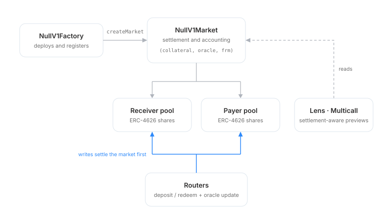
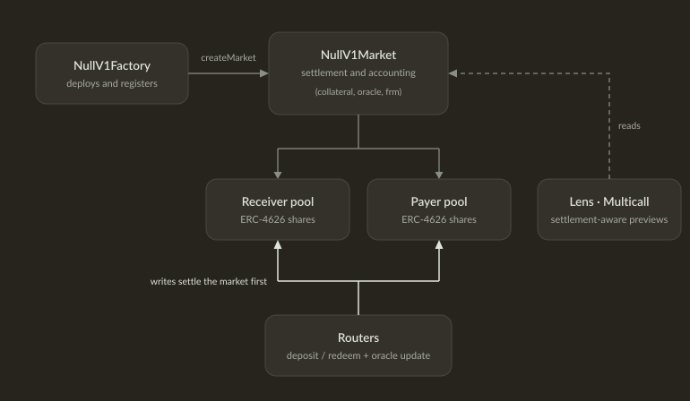

Null's private beta runs on Ethereum mainnet smart contracts. This page gives a structural overview. For ABIs, functions, and integration details, see the [Developers](/developers/overview) docs.

## Structure

<Frame>
  
  
</Frame>

A market is uniquely identified by an immutable tuple:

```text
(collateral, oracle, funding-rate model)
```

A different set of dependencies creates a different market. Once a market is created, those addresses cannot be changed.

## Core contracts

### Factory

`NullV1Factory` creates and registers markets. Anyone can create a market using an enabled funding-rate model. Use the canonical factory on the [addresses page](/resources/addresses) when verifying a market.

### Market

`NullV1Market` holds the collateral, tracks how much belongs to each pool, and settles price PnL, funding, and fees. Settlement happens when someone interacts with a pool. There is no separate action required each block.

### Receiver and Payer pools

Each market has two `NullV1Pool` contracts: Receiver and Payer. Both issue transferable ERC-4626 shares. The pools track ownership, while the market holds the collateral.

## Supporting contracts

| Contract | Role |
| --- | --- |
| **Oracle** | Reports the tracked price used at settlement. The tracked asset never enters Null. |
| **Funding-rate model (FRM)** | Returns the signed funding rate between Receiver and Payer. Fixed at market creation. |
| **Router** | Combines deposits, redemptions, deadlines, slippage checks, and optional oracle updates. |
| **Lens / Multicall** | Settlement-aware previews and batched reads. |

## What stays fixed vs owner-controlled

**Fixed per market:** collateral, oracle, FRM, Receiver pool, and Payer pool.

**Factory owner can:** enable FRMs for future markets, set fees within contract caps, and collect reserved protocol fees. The owner cannot replace an existing market's dependencies or withdraw collateral allocated to the pools.

## Where to go next

- [Factory](/contracts/factory), [Market](/contracts/market), and [Pool](/contracts/pool) interfaces
- [Ethereum mainnet addresses](/resources/addresses)
- [Audits](/private-beta/support/audits): Nethermind Security reviewed Null V1 (NM-1028; all five findings Fixed)
- [Risks and parameters](/learn/risks-and-parameters)

<Warning>
Onchain structure lets you inspect the rules and state. It does not guarantee that the code or oracle is correct, that collateral is risk-free, or that a trade will be profitable.
</Warning>
