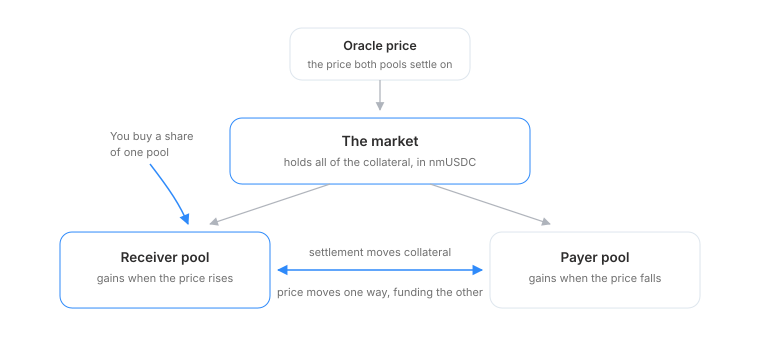
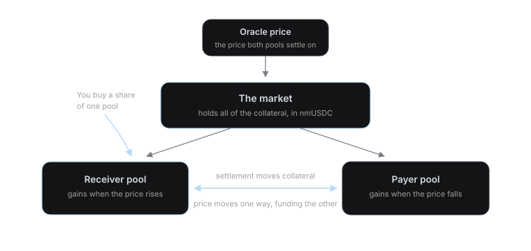

Null is a **two-pool system**. Every market has two sides:

- **Receiver** gets the oracle-tracked price return.
- **Payer** provides the backing and takes the other side.

Both pools use the same collateral token. The market holds that collateral and moves value between the pools at settlement. The protocol does not lend the tracked asset, open margin accounts, or liquidate individual users.

<Frame>
  
  
</Frame>

## How the two pools work together

Let `R` be Receiver pool assets and `P` be Payer pool assets.

- When the accepted oracle price **rises**, value normally moves from Payer → Receiver.
- When it **falls**, value normally moves from Receiver → Payer.
- **Funding** moves vault yield from the Receiver pool to the Payer pool. It is paid from collateral APR, not from a separate signed imbalance rate.

Settlement only moves collateral already held by the market, subject to a minimum-pool floor. The tracked asset is never borrowed for Spot. Leveraged Margin uses Morpho separately; see [Morpho](/learn/morpho).

<Info>
You do not own or receive the tracked asset. A Receiver position does not include voting rights, dividends, or other ownership benefits unless the market's oracle return explicitly reflects them.
</Info>

## Positions

A position is your share of one pool. You choose a side, deposit collateral, and receive transferable ERC-4626 shares. Your position represents a percentage of the pool, not a trade with a fixed counterparty or entry price.

### Receiver

Receiver follows the tracked price return. A 5% accepted price increase adds about 5% to Receiver assets. A 5% decrease reduces them by about 5%, before funding, fees, collateral changes, and settlement bounds.

### Payer

Payer provides the backing for Receiver. Economically, a Payer is a **negative-size position in the Receiver pool**, with the market's collateral held inside that structure. It takes the opposite side of the price movement and receives funding paid from Receiver-side collateral yield.

The short's notional relative to Payer capital scales with the pool ratio:

```text
short scale = R / P
```

That ratio is not chosen by the user or fixed when they enter. It changes as the assets in either pool change. A Payer holder with current position value `p` has short notional:

```text
Payer short notional = p * R / P
```

As coverage falls, `|R / P|` rises. The same Receiver-side transfer then has a larger impact on Payer share value.

## Worked examples

These examples ignore funding, fees, collateral changes, rounding, and settlement bounds unless noted. Start from `R = 1,000` Receiver assets.

### Price rises

Suppose `P = 200` and the accepted oracle price rises by 2%. The price transfer is about 2% of Receiver assets, or 20 collateral units:

```text
Receiver: 1,000 → 1,020
Payer:      200 →   180
```

Short scale is `R / P = 1,000 / 200 = 5`. Receiver increases by 2%. The same 20-unit transfer reduces the Payer pool by 10%:

```text
Payer return ≈ -price move × (R / P) ≈ -2% × 5 ≈ -10%
```

### Price falls

Same pools, accepted oracle price falls by 2%. The transfer reverses:

```text
Receiver: 1,000 →   980
Payer:      200 →   220
```

Receiver decreases by 2%. Payer receives the same 20-unit transfer, increasing the pool by about 10% at short scale `5`.

### Same move, different coverage

A 2% accepted price rise always moves about `0.02 * R` from Payer to Receiver. Coverage changes how hard that hits Payer:

| Payer `P` | Coverage `P/R` | Short scale `R/P` | Transfer | Receiver | Payer return |
| --------: | -------------: | ----------------: | -------: | -------: | -----------: |
|       500 |            50% |                2× |       20 |     +2% |         -4% |
|       200 |            20% |                5× |       20 |     +2% |        -10% |
|       100 |            10% |               10× |       20 |     +2% |        -20% |

Lower coverage means a larger negative Receiver size relative to Payer capital, so the same oracle move has a larger percentage impact on the Payer.

### Your share of a pool

Pools are shared. If the Payer pool is `P = 200` and you hold `50` of it (25% of the pool), your position receives 25% of every Payer-side transfer.

After the +2% price example above (`P: 200 → 180`):

```text
Your Payer claim: 50 → 45
Your return:      -10%  (same as the pool)
```

When others mint or burn, the pool size and your percentage can change. Your share of the next transfer changes with it.

### Funding from collateral APR

Funding is a share of the collateral vault's APR. Receivers pay that yield on Receiver notional to Payers. Payers do not pay funding back.

Example with collateral APR `y = 8%`, full yield share `s = 1`, and `R = 1,000`:

| Payer `P` | Coverage | Funding APR `f` | Annual transfer | Payer carry from funding (approx.) |
| --------: | -------: | --------------: | --------------: | --- |
|       200 |      20% |             8% |              80 | `80 / 200 = 40%` on Payer capital |
|     1,000 |     100% |             8% |              80 | `80 / 1,000 = 8%` |
|     2,000 |     200% |             8% |              80 | `80 / 2,000 = 4%` |

Coverage no longer flips the funding sign. It still changes how the same Receiver-notional transfer lands per unit of Payer (`f × R / P`), and it still sets the Payer short scale `R / P`.

Funding varies with vault yield. It is not guaranteed profit after hedge costs. Full write-up: [Funding and carry](/learn/funding-and-carry).

## Entering and exiting a position

<Steps>
  <Step title="Review the market">
    Check the tracked price, collateral, oracle, pool sizes, collateral APR, funding APR, fees, and circuit-breaker behavior.
  </Step>
  <Step title="Choose a pool">
    Choose Receiver for the tracked return, or Payer for a negative-size position in the Receiver pool (short scale `R / P`).
  </Step>
  <Step title="Receive shares">
    Deposit collateral and receive ERC-4626 shares in that pool.
  </Step>
  <Step title="Monitor">
    Pool sizes, funding, fees, collateral value, and oracle settlement can all affect the value of your shares.
  </Step>
  <Step title="Burn shares">
    Redeem for your proportional claim after the market settles and applicable fees apply.
  </Step>
</Steps>

Pool shares are transferable, but that does not guarantee an active secondary market or a particular redemption value. Yield-bearing collateral moves both pools through reconciliation. Funding then transfers Receiver-side vault yield to Payers.

## Settlement

Settlement is interaction-driven. Deposits, mints, withdrawals, and redemptions settle the market before continuing. There is no separate public keeper action that updates every block.

During settlement, the market reconciles collateral, accrues fees, reads the oracle and funding-rate model, and nets price PnL with funding. Product funding is driven by collateral yield paid to Payers. The number of shares does not change, but the collateral value each share represents does.

If an accepted oracle move exceeds the time-adjusted circuit-breaker threshold, the market skips that update's price transfer and records the new price as its next baseline. Funding can still settle. The skipped price PnL is not deferred.

## What stays fixed

Each market is uniquely identified by three dependency addresses:

```text
(collateral, oracle, funding-rate model)
```

Those dependencies and the two pool addresses are fixed for that market. A different tuple creates a different market.

The factory owner can enable funding-rate models for future markets, set capped fees, and collect accrued protocol fees. Review the current market and fee settings before entering.

<Warning>
Receiver and Payer can lose most of their pool value. The minimum-pool floor and circuit breaker constrain specific transfers; they do not guarantee fair pricing, liquidity, or capital protection.
</Warning>

Continue with [Position types](/private-beta/trading/position-types), [Smart contracts](/private-beta/about-null/smart-contracts), or [Funding and carry](/learn/funding-and-carry).
