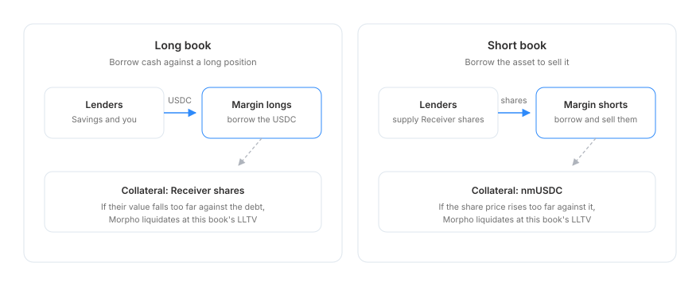

Lending is for people who looked at [Savings](/products/savings) and asked a reasonable follow-up question: which book, exactly, is earning that rate, and could I choose it myself? Yes. Lending is the same Morpho books that the **Null Savings Vault** lends into, opened up so you can supply them directly, market by market, and recall your money under your own control.

That control is the whole point of the product, and also its price. Savings blends everything into one AER and one balance. Lending hands you a full book of individual opportunities, each with its own rate and its own liquidity, and expects you to have a view on which ones deserve your capital. If that sounds like work you would enjoy, this is your page. If it does not, Savings was built for you.

<Frame>
  
  
</Frame>

## Why this exists

Leveraged traders need lenders the way a bank needs depositors. Every [Margin](/products/margin) long borrows USDC from someone, and every Margin short borrows Receiver shares from someone. Lending is where that someone is you, paid a market rate for making the trade possible.

Doing it directly, rather than through the vault, buys you two things. You can favour books whose rates you find attractive and avoid ones you do not, and you can lend an asset Savings never touches: Receiver shares themselves. That second option is what makes the short side of Null function, because shorts cannot exist unless somebody is willing to part with shares for a while.

## How it connects to the primitive

Each wired Null market sits between two books, and [Morpho markets](/concepts/morpho-markets) lays out the architecture. One book faces each direction of trade. On the long book you lend USDC, labelled in the style of `USDC | AAPL`, meaning USDC is the loan asset and the market's Receiver share is the collateral behind the borrowing. Margin longs draw on this book. On the short book the relationship flips: you lend Receiver shares into a book labelled like `AAPL | nmUSDC`, and Margin shorts borrow those shares against `nmUSDC` collateral.

Notice what this means about your exposure. Lending USDC keeps you neutral on the underlying price; you are a creditor, and your outcome depends on borrowers and their collateral. Lending Receiver shares is different, because the asset in your hand is itself a share of the Receiver pool from [the primitive](/concepts/the-primitive). While it is supplied, its value still moves with the pool, so you are combining a lending return with the price exposure you would have had on [Spot](/products/spot). Neither choice is better in the abstract. They are answers to different questions about what you want to own.

## Using the lending book

The full book lives at `/lending`, and your current positions are summarised under **Home** and then **Lending**. The book rewards a slow first read. Its columns run from **Loan** and **Collateral**, which tell you what a book lends and what stands behind it, through **Outstanding Loans** and **Total Liquidity**, which tell you how busy and how deep it is, to **Your Supplied**, **Your Interest Earnt**, and **Lend Rate**, which are the three numbers that describe your own position in it.

<Steps>
  <Step title="Choose a book">
    Decide whether you are lending USDC into a long book or Receiver shares into a short book. That choice determines both your return and what you are exposed to while the money is out.
  </Step>
  <Step title="Lend">
    Select **Lend**, enter an amount, and confirm. Your balance starts earning the book's **Lend Rate**, which floats with how much of the book borrowers are using.
  </Step>
  <Step title="Recall">
    Choose **Recall** to take assets back, up to the liquidity currently free in the book. If borrowers are using most of it, recall what is available now and the rest as loans are repaid.
  </Step>
</Steps>

That recall limit is not a penalty or a lockup someone imposed on you. It is arithmetic: lent money is, by definition, in someone else's hands. Watching **Total Liquidity** against **Outstanding Loans** before you lend gives you a fair sense of how quickly you could expect to exit a book in full.

## What it costs and what can go wrong

Your return is interest paid by borrowers, expressed as the **Lend Rate**, and it moves. Quiet books pay little because nobody needs the money; busy books pay more because traders are competing for a limited supply. There is no Null funding flowing to you as a lender, because funding is a transfer between Receiver and Payer pools, and it never goes negative or leaks out to bystanders. [Funding and yield](/concepts/funding-and-yield) explains that separation, and [Fees](/concepts/fees) covers what the wider system charges.

The risk that matters most is the one lending always carries. Your borrowers post collateral, and if a position is liquidated for less than the debt it secures, the shortfall is where lenders can lose principal. [Risks](/concepts/risks) treats this properly, alongside oracle and smart contract risk across both Null and Morpho. Add the practical risk that a heavily used book cannot return your full balance on demand, and the picture is complete: lend money you can leave lent.

If choosing books stops sounding appealing, [Savings](/products/savings) will happily make these decisions for you in exchange for a blended rate.
