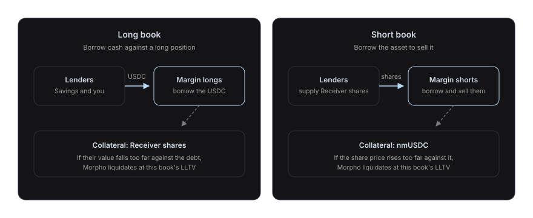

**Lending** supplies assets to the Morpho books that sit beside Null markets. You earn the book's lend rate. You do not take Receiver or Payer price exposure unless the asset you supply is itself a Receiver share.

<Frame>
  
  
</Frame>

<Frame>
  
  
</Frame>

## How it uses the primitive

Each wired Null market has two books. See [Morpho markets](/concepts/morpho-markets).

| What you lend | Book | Pair label | Borrower |
| --- | --- | --- | --- |
| USDC | Long | `USDC \| AAPL` (loan, then collateral) | Margin longs, who post Receiver shares |
| Receiver shares | Short | `AAPL \| nmUSDC` | Margin shorts, who post `nmUSDC` |

The **Null Savings Vault** is a lender on the long books. Lending is the same books, supplied directly from your wallet, with **Lend** and **Recall** instead of **Add money**.

## What you see

- **Home → Lending** (`/?section=lending`) summarizes positions. An empty overview row reads **No lending yet**. **Lend** opens the full book.
- `/lending` is the full book. `?id=` focuses one row.
- Columns include **Loan**, **Collateral**, **Outstanding Loans**, **Total Liquidity**, **Your Supplied**, **Your Interest Earnt**, and **Lend Rate**.
- Home position columns include **Market**, **Supplied**, **Interest Earnt**, **APY**, and **Value**.
- The slide-out adds **Borrow rate**, **LLTV**, and your balances.
- Actions are **Lend** and **Recall**.

## Steps

<Steps>
  <Step title="Pick a book">
    Open `/lending`. Choose a USDC long book or a Receiver-share short book.
  </Step>
  <Step title="Lend">
    Enter an amount, review the lend rate and LLTV, and confirm.
  </Step>
  <Step title="Earn">
    Interest accrues on your supplied balance. The rate changes with utilization.
  </Step>
  <Step title="Recall">
    Withdraw up to the liquidity borrowers have not taken. If utilization is high, recall a smaller amount or wait.
  </Step>
</Steps>

## Rates and fees

You earn **Lend Rate** / **APY** from Morpho borrowers. You do not receive Null funding unless you also hold a Payer position. Gas applies. Morpho's own interest fee, if configured on that book, comes out of borrower interest.

## Risks

- Borrowers can be liquidated. If collateral does not cover the debt, lenders can lose principal.
- **Recall** can be delayed when liquidity is in use.
- Lending Receiver shares means the asset you supplied can change value with the Null pool before you recall it.
- Oracle and smart-contract risk apply to both Null and Morpho.

Savings is the simpler USDC path. Lending is the direct path, including share books Savings does not use.
