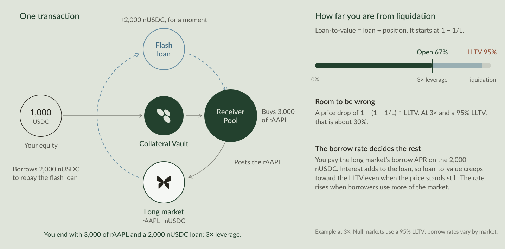
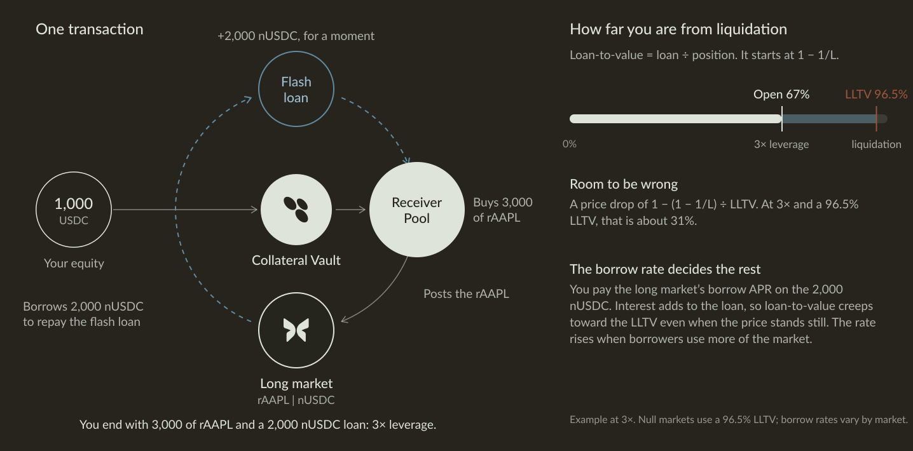
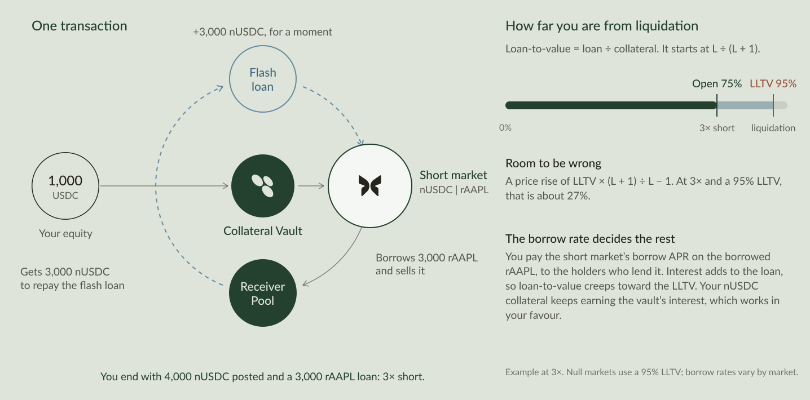

Margin is for when a view no longer fits inside your cash. You borrow, so a given price move matters more than it would on Spot. That cuts both ways, which is why Margin has its own desk and the one thing Spot never has: a liquidation price.

<Frame>
  
  
</Frame>

## How it works

| | Leverage Long | Leverage Short |
| --- | --- | --- |
| Market | The long market, such as `AAPLr \| nUSDC` | The short market, such as `nUSDC \| AAPLr` |
| You post | AAPLr | nUSDC |
| You borrow | nUSDC, from the Savings Vault and other lenders | AAPLr, from holders who lend it |
| What happens | The borrowed nUSDC buys more AAPLr than your own money could. | The borrowed AAPLr is sold. You repay it later, hopefully cheaper. |
| You pay | **Long borrow APR** | **Short borrow APR** |

Underneath, the price exposure is the same Receiver Pool share as on [Spot](/products/spot). Margin just borrows against it. It is usually cheaper than a perp, because USDC borrow rates tend to run below perp DEX funding.

## How the loop works

The desk opens a leveraged position in one transaction, using a flash loan: money borrowed and repaid inside the same transaction.

### Leverage Long

| Step | What happens, at 3× on 1,000 USDC |
| --- | --- |
| Deposit | Your 1,000 USDC goes into the Collateral Vault, which mints 1,000 nUSDC. |
| Flash loan | The router borrows 2,000 nUSDC for a moment. |
| Buy | The 3,000 nUSDC buys 3,000 of AAPLr in the Receiver Pool. |
| Post | The AAPLr is posted as collateral on the long market. |
| Borrow and repay | The long market lends 2,000 nUSDC, which repays the flash loan. |

You end with 3,000 of AAPLr and a 2,000 nUSDC loan. Closing runs the same loop in reverse.

### Leverage Short

<Frame>
  
  
</Frame>

| Step | What happens, at 3× on 1,000 USDC |
| --- | --- |
| Deposit | Your 1,000 USDC goes into the Collateral Vault, which mints 1,000 nUSDC. |
| Flash loan | The router borrows 3,000 nUSDC for a moment. |
| Post | All 4,000 nUSDC is posted as collateral on the short market. |
| Borrow and sell | The short market lends 3,000 of AAPLr, which is sold to the Receiver Pool for 3,000 nUSDC. |
| Repay | That 3,000 nUSDC repays the flash loan. |

You end with 4,000 nUSDC posted and a 3,000 AAPLr loan: you gain if AAPLr falls. Your nUSDC collateral keeps earning interest while the position is open. Closing mints the AAPLr you owe and repays the loan.

The borrow rate is what holding costs. You pay it on the whole loan for as long as the position is open, it adds to the debt, and it rises when borrowers use more of the market. Leverage only pays if the price move beats it.

## Worked examples

**Carry** is what a position earns minus what it pays, per year, in dollars. It is the cost of holding before the price moves. Two things drive it:

- Your **borrow APR**, paid on the loan.
- **nUSDC interest.** nUSDC grows in value as the Collateral Vault earns. That helps you when you hold nUSDC (a short's collateral) and costs you when you owe it (a long's loan).

```text
long carry  ≈ - loan × (long borrow APR + nUSDC interest)
short carry ≈ collateral × nUSDC interest - loan × short borrow APR
```

The examples below use 1,000 USDC of equity and illustrative rates: nUSDC interest 5%, long borrow APR 4%, short borrow APR 2%. Live rates are on the market page and change all the time: **Overview** shows each side's **carry** rate, and **Details** shows the borrow APRs and **Collateral APR** behind it. Fees are left out.

### 3× long on AAPLr

You hold 3,000 of AAPLr against a 2,000 nUSDC loan. Loan-to-value starts at 67%.

| | |
| --- | --- |
| AAPLr rises 10% | Position 3,300, loan 2,000. Your equity is 1,300: **+30%**. |
| AAPLr falls 10% | Position 2,700, loan 2,000. Your equity is 700: **−30%**. |
| Liquidation | A fall of about 31%. |
| Carry | Borrow costs 80 a year and the nUSDC loan grows by about 100 in dollars: about **−180 a year**, or 15 a month. AAPLr has to rise about 6% a year just to cover it. |
| After a year, price flat | The loan is about 2,180, loan-to-value about 73%, and the fall to liquidation shrinks to about 25%. |

### 3× short on AAPLr

You post 4,000 nUSDC against a loan of 3,000 of AAPLr. Loan-to-value starts at 75%.

| | |
| --- | --- |
| AAPLr falls 10% | The loan is worth 2,700. Your equity is 1,300: **+30%**. |
| AAPLr rises 10% | The loan is worth 3,300. Your equity is 700: **−30%**. |
| Liquidation | A rise of about 29%. |
| Carry | Your collateral earns about 200 a year and borrowing costs 60: about **+140 a year**. You are paid to wait, as long as the short borrow APR stays below the interest your collateral earns. |
| After a year, price flat | Collateral is about 4,200, the loan about 3,060, and the rise to liquidation grows to about 32%. |

### 10× long on AAPLr

You hold 10,000 of AAPLr against a 9,000 nUSDC loan. Loan-to-value starts at 90%.

| | |
| --- | --- |
| AAPLr rises 5% | Your equity is 1,500: **+50%**. |
| Liquidation | A fall of about 6.7%. |
| Carry | About **−810 a year**, or 68 a month, on 1,000 of equity. |
| Price flat | Carry alone pushes loan-to-value to 96.5% in about ten months. You can be liquidated without the price moving. |

The pattern: a long pays both its borrow rate and nUSDC interest on the whole loan, so carry grows quickly with leverage. A short earns nUSDC interest on its collateral, so its carry can be positive. Spot has no loan, no carry and no liquidation.

## Using the desk

The desk is only reached through **Home** and then **Margin**. It opens with a market picker, with search and a **Favourites** tab.

<Steps>
  <Step title="Pick a market and a side">
    Choose a market, then the **Long** or **Short** tab. A side only shows where its Morpho market is set up.
  </Step>
  <Step title="Read the rates">
    **Overview** shows the **Long carry** and **Short carry**: borrow cost and collateral interest combined, as a yearly rate per unit borrowed. **Details** splits them into the **Long borrow APR**, **Short borrow APR** and **Collateral APR**, and **Parameters** shows the **LLTV** and max leverage. The **Carry chart** plots both over time; the **Rates chart** plots the parts. Borrow rates differ by market; the LLTV is 96.5%.
  </Step>
  <Step title="Build the ticket">
    The ticket shows your **Position**, the **Loan (USDC)** it needs and the **Liquidation price**. Resize until that last number is one you can live with.
  </Step>
  <Step title="Place the order">
    Select **Place Order** and confirm. The position now accrues borrow interest for as long as you hold it.
  </Step>
</Steps>

Open positions sit under **My Positions**, each with its **Liq. price** and **Carry**: the running net of interest and borrow cost. **Close** ends the trade and repays the loan. **My Activity** keeps your history.

## Liquidation, in plain terms

Null markets use a 96.5% LLTV. On a long, opening at leverage `L` starts your loan-to-value at `1 - 1/L`. When it climbs to 96.5%, through a price move or accruing interest, Morpho can liquidate you. As a price drop:

```text
drop to liquidation = 1 - (1 - 1/L) / LLTV
```

At 3× that is about a 31% drop; at 5×, about 17%; at 10×, about 6.7%.

A short starts at `L / (L + 1)` and is liquidated by a price rise of `0.965 × (L + 1) / L - 1`: about 29% at 3×, 16% at 5×, 6% at 10×.

 If you come from perps, don't reuse the perp formula `(1/L - mm) / (1 - mm)`. The leverage slider stays below `1 / (1 - 0.965)`, about 28.6×, and stops at 25×, and interest slowly shrinks your distance to liquidation even if the price sits still.

## Costs and risks

| | |
| --- | --- |
| Borrow interest | The borrow APR for your side, for the life of the position. |
| Fees | The market's entry and exit fees when the desk buys and sells. See [Fees](/how-null-works/what-it-costs). |
| Liquidation | Reach the 96.5% LLTV and Morpho can sell your collateral, often at the worst moment. You may keep little or nothing. |
| Fast markets | Oracle faults, thin liquidity and contract risk all shorten the time you have to react. |

Margin turns being wrong from a drawdown into a deadline. Size it so the deadline never arrives, and keep your Savings money out of it. More in [Risks](/how-null-works/what-can-go-wrong).
