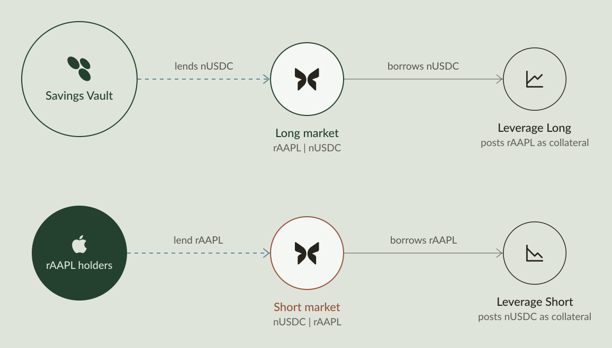

Margin is for when a view no longer fits inside your cash. You borrow, so a given price move matters more than it would on Spot. That cuts both ways, which is why Margin has its own desk and the one thing Spot never has: a liquidation price.

<Frame>
  
</Frame>

## How it works

| | Leverage Long | Leverage Short |
| --- | --- | --- |
| Market | The long market, such as `rAAPL \| nUSDC` | The short market, such as `nUSDC \| rAAPL` |
| You post | rAAPL | nUSDC |
| You borrow | nUSDC, from the Savings Vault and other lenders | rAAPL, from holders who lend it |
| What happens | The borrowed nUSDC buys more rAAPL than your own money could. | The borrowed rAAPL is sold. You repay it later, hopefully cheaper. |
| You pay | **Long borrow APR** | **Short borrow APR** |

Underneath, the price exposure is the same Receiver Pool share as on [Spot](/products/spot). Margin just borrows against it. It is usually cheaper than a perp, because USDC borrow rates tend to run below perp DEX funding.

## Using the desk

The desk is only reached through **Home** and then **Margin**. It opens with a market picker, with search and a **Favourites** tab.

<Steps>
  <Step title="Pick a market and a side">
    Choose a market, then the **Long** or **Short** tab. A side only shows where its Morpho market is set up.
  </Step>
  <Step title="Read the parameters">
    **Parameters** shows the **Long borrow APR**, **Short borrow APR**, **LLTV** and max leverage. They differ by market.
  </Step>
  <Step title="Build the ticket">
    The ticket shows your **Position**, the **Loan (USDC)** it needs and the **Liquidation price**. Resize until that last number is one you can live with.
  </Step>
  <Step title="Place the order">
    Select **Place Order** and confirm. The position now accrues borrow interest for as long as you hold it.
  </Step>
</Steps>

Open positions sit under **My Positions**, each with its **Liq. price** and **Carry**: the running net of interest and borrow cost. **Close** ends the trade and repays the loan. **My Activity** keeps your history.

## Liquidation, in plain terms

Opening at leverage `L` starts your loan-to-value at `1 - 1/L`. When it climbs to the market's LLTV, through a price move or accruing interest, Morpho can liquidate you. As a price drop:

```text
drop to liquidation = 1 - (1 - 1/L) / LLTV
```

If you come from perps, don't reuse the perp formula `(1/L - mm) / (1 - mm)`. The two only match at particular LLTVs. Always check the live LLTV on **Parameters**. The leverage slider stays below `1 / (1 - LLTV)`, and interest slowly shrinks your distance to liquidation even if the price sits still.

## Costs and risks

| | |
| --- | --- |
| Borrow interest | The borrow APR for your side, for the life of the position. |
| Fees | The market's entry and exit fees when the desk buys and sells. See [Fees](/concepts/fees). |
| Liquidation | Reach LLTV and Morpho can sell your collateral, often at the worst moment. You may keep little or nothing. |
| Fast markets | Oracle faults, thin liquidity and contract risk all shorten the time you have to react. |

Margin turns being wrong from a drawdown into a deadline. Size it so the deadline never arrives, and keep your Savings money out of it. More in [Risks](/concepts/risks).
