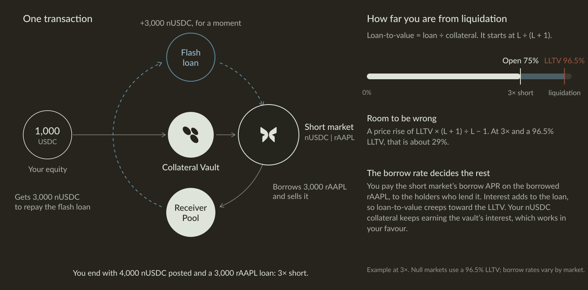

Margin is for when a view no longer fits inside your cash. You borrow, so a given price move matters more than it would on Spot. That cuts both ways, which is why Margin has its own desk and the one thing Spot never has: a liquidation price.

<Frame>
  
  
</Frame>

## How it works

| | Leverage Long | Leverage Short |
| --- | --- | --- |
| Market | The long market, such as `rAAPL \| nUSDC` | The short market, such as `nUSDC \| rAAPL` |
| You post | rAAPL | nUSDC |
| You borrow | nUSDC, from the Savings Vault and other lenders | rAAPL, from holders who lend it |
| What happens | The borrowed nUSDC buys more rAAPL than your own money could. | The borrowed rAAPL is sold. You repay it later, hopefully cheaper. |
| You pay | **Long borrow APR** | **Short borrow APR** |

Underneath, the price exposure is the same Receiver Pool share as on [Spot](/products/spot). Margin just borrows against it. It is usually cheaper than a perp, because USDC borrow rates tend to run below perp DEX funding.

## How the loop works

The desk opens a leveraged position in one transaction, using a flash loan: money borrowed and repaid inside the same transaction.

### Leverage Long

| Step | What happens, at 3× on 1,000 USDC |
| --- | --- |
| Deposit | Your 1,000 USDC goes into the Collateral Vault, which mints 1,000 nUSDC. |
| Flash loan | The router borrows 2,000 nUSDC for a moment. |
| Buy | The 3,000 nUSDC buys 3,000 of rAAPL in the Receiver Pool. |
| Post | The rAAPL is posted as collateral on the long market. |
| Borrow and repay | The long market lends 2,000 nUSDC, which repays the flash loan. |

You end with 3,000 of rAAPL and a 2,000 nUSDC loan. Closing runs the same loop in reverse.

### Leverage Short

<Frame>
  
  
</Frame>

| Step | What happens, at 3× on 1,000 USDC |
| --- | --- |
| Deposit | Your 1,000 USDC goes into the Collateral Vault, which mints 1,000 nUSDC. |
| Flash loan | The router borrows 3,000 nUSDC for a moment. |
| Post | All 4,000 nUSDC is posted as collateral on the short market. |
| Borrow and sell | The short market lends 3,000 of rAAPL, which is sold to the Receiver Pool for 3,000 nUSDC. |
| Repay | That 3,000 nUSDC repays the flash loan. |

You end with 4,000 nUSDC posted and a 3,000 rAAPL loan: you gain if rAAPL falls. Your nUSDC collateral keeps earning interest while the position is open. Closing mints the rAAPL you owe and repays the loan.

The borrow rate is what holding costs. You pay it on the whole loan for as long as the position is open, it adds to the debt, and it rises when borrowers use more of the market. Leverage only pays if the price move beats it.

## Using the desk

The desk is only reached through **Home** and then **Margin**. It opens with a market picker, with search and a **Favourites** tab.

<Steps>
  <Step title="Pick a market and a side">
    Choose a market, then the **Long** or **Short** tab. A side only shows where its Morpho market is set up.
  </Step>
  <Step title="Read the parameters">
    **Parameters** shows the **Long borrow APR**, **Short borrow APR**, **LLTV** and max leverage. Borrow rates differ by market; the LLTV is 95%.
  </Step>
  <Step title="Build the ticket">
    The ticket shows your **Position**, the **Loan (USDC)** it needs and the **Liquidation price**. Resize until that last number is one you can live with.
  </Step>
  <Step title="Place the order">
    Select **Place Order** and confirm. The position now accrues borrow interest for as long as you hold it.
  </Step>
</Steps>

Open positions sit under **My Positions**, each with its **Liq. price** and **Carry**: the running net of interest and borrow cost. **Close** ends the trade and repays the loan. **My Activity** keeps your history.

## Liquidation, in plain terms

Null markets use a 95% LLTV. On a long, opening at leverage `L` starts your loan-to-value at `1 - 1/L`. When it climbs to 95%, through a price move or accruing interest, Morpho can liquidate you. As a price drop:

```text
drop to liquidation = 1 - (1 - 1/L) / LLTV
```

At 3× that is about a 30% drop; at 5×, about 16%; at 10×, about 5%.

A short starts at `L / (L + 1)` and is liquidated by a price rise of `0.95 × (L + 1) / L - 1`: about 27% at 3×, 14% at 5×, 4.5% at 10×.

 If you come from perps, don't reuse the perp formula `(1/L - mm) / (1 - mm)`. The leverage slider stays below `1 / (1 - 0.95)`, so under 20×, and interest slowly shrinks your distance to liquidation even if the price sits still.

## Costs and risks

| | |
| --- | --- |
| Borrow interest | The borrow APR for your side, for the life of the position. |
| Fees | The market's entry and exit fees when the desk buys and sells. See [Fees](/concepts/fees). |
| Liquidation | Reach the 95% LLTV and Morpho can sell your collateral, often at the worst moment. You may keep little or nothing. |
| Fast markets | Oracle faults, thin liquidity and contract risk all shorten the time you have to react. |

Margin turns being wrong from a drawdown into a deadline. Size it so the deadline never arrives, and keep your Savings money out of it. More in [Risks](/concepts/risks).
