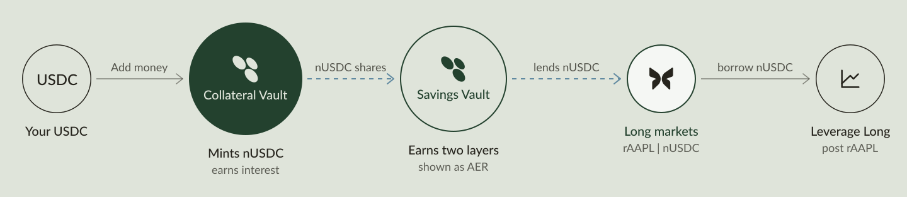
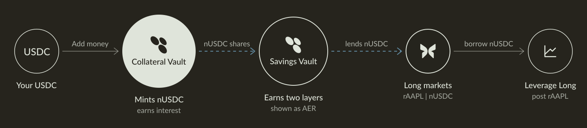

Savings is for USDC you want working while you decide what to do next. You don't track a price, a funding rate or a liquidation level. You add money, it earns, and you withdraw when you need it.

<Frame>
  
  
</Frame>

## How it earns

Your deposit becomes nUSDC, a share of the [Null Collateral Vault](/concepts/collateral-vault), and goes into the Null Savings Vault. The Savings Vault lends that nUSDC into the long market of every synthetic, where Leverage Long traders borrow it.

| Layer | Where it comes from |
| --- | --- |
| First | nUSDC earns interest in the Null Collateral Vault. |
| Second | Borrowers on the long markets pay interest to the Savings Vault. |

The app shows the combined rate as **AER**, to two decimal places. It is a snapshot of what the vault earns now, not a promise about the year ahead. If the app can't fetch a rate, it says so rather than show a stale one.

You hold no Receiver or Payer position. Nothing in your balance rises or falls with the price of a stock or coin.

## Using Savings

Go to **Home** and then **Savings**. Your balance shows as **Null Savings Vault**, with the current **AER** beside it.

<Steps>
  <Step title="Add money">
    Choose **Add money**, enter an amount of USDC and confirm. Interest accrues through the value of your vault shares, not as separate payments.
  </Step>
  <Step title="See where it's lent">
    Open **Info** for the **Alloc.** table. It shows each long market the vault lends into, by **Collateral**, **%** and **APY**.
  </Step>
  <Step title="Withdraw">
    Choose **Withdraw** and take out up to the amount free right now. If most of the vault is lent, take what's free now and the rest as borrowers repay.
  </Step>
</Steps>

Your history sits in a ledger with **Transaction**, **Date**, **Status**, **Account** and **Amount**. There is no claim step and no lock-up.

## Costs and risks

| | |
| --- | --- |
| Fees | No Null fee on Savings. You pay gas for **Add money** and **Withdraw**. |
| The rate moves | It rises when traders borrow more and falls when markets are quiet. |
| Withdrawals | Limited by what borrowers aren't using. Savings suits money you don't need on a precise date. |
| Lending risk | If a borrower is liquidated for less than the debt, lenders can lose principal. |
| Vault risk | If the Collateral Vault loses value, your nUSDC does too. |

This is not a bank deposit and it is not insured. Size it like an onchain lending position, because that is what it is. More in [Risks](/concepts/risks).

Want to choose the markets yourself? Use [Lending](/products/lending). Want price exposure instead? Start with [Spot](/products/spot).
