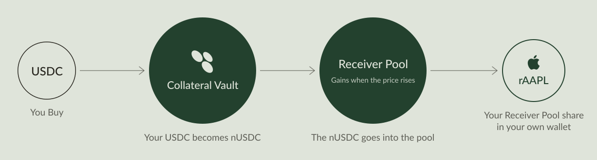
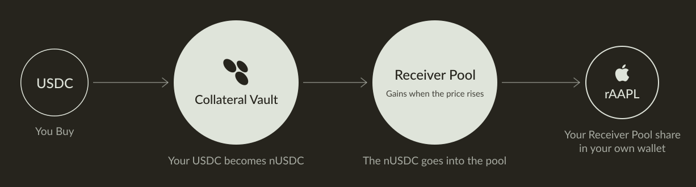

Spot is Null in its simplest form. You want a price in your wallet, without borrowing and without watching a liquidation level. Spot gives you that and nothing else.

<Frame>
  
  
</Frame>

## What you're buying

**Buy** puts you in a market's Receiver pool. You get a Receiver Pool share, a synthetic such as rAAPL, that rises and falls with the asset. You don't own the asset itself, and nobody holds it for you. [Two pools](/how-null-works/nusdc-backs-two-pools) explains the machinery.

Holding has one ongoing cost: the interest your deposit earns goes to Payers. On a perp you would pay funding on your whole position instead.

## Using Spot

Markets are listed at `/trade`. Your positions are under **Home** and then **Spot**.

<Steps>
  <Step title="Pick a market">
    Open a market on `/trade`. Check its price and rates first. Two markets on similar assets can carry different rates.
  </Step>
  <Step title="Buy or sell">
    **Buy** opens or adds to a Receiver position. **Sell** reduces it. **Receive** is not a trade: it shows your wallet address and a QR code so someone can send you assets.
  </Step>
  <Step title="Review, then confirm">
    Every trade has a review step before your wallet signs. The fee is included in the amount you see.
  </Step>
  <Step title="Want the other side? Turn on Pro Mode">
    In the account menu, turn on **Pro Mode**. The ticket then adds **Payer buy** and **Payer sell**. Read [Payers](/payers) first.
  </Step>
</Steps>

Selling is the whole exit. There is no expiry, no debt to repay and nothing waiting for the price to touch a line.

## Make it earn

Once you hold a synthetic, you can lend it into its short market through [Lending](/products/lending). You keep the price exposure and earn interest on top.

## Costs and risks

| | |
| --- | --- |
| Fees | The market's entry and exit fee, folded into the amount you review. See [Fees](/how-null-works/what-it-costs). |
| Interest | As a Receiver you give up your deposit's interest. Your position can drift slightly from the pure price move because of it. |
| Price | Prices fall as well as rise. A Payer position moves faster than the price, scaled by `R / P`. |
| Feeds and contracts | Oracles can misbehave and contracts carry risk. See [Risks](/how-null-works/what-can-go-wrong). |
