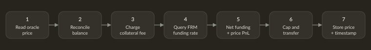

Settlement runs inside `NullV1Market._updateState`, which pool `deposit` and `redeem` call before they move shares. There is no public keeper that must poke every block. A direct `updateState` from outside the pools is rejected.

<Frame>
  
  
</Frame>

## Prepare

`prepareUpdate` does two things with the market's collateral balance.

**Reconcile.** Booked assets are `receiverPool + payerPool + protocolFees`. If the token balance is higher, the surplus is split across the two pools in proportion to their balances. If both pools are empty, the surplus goes to protocol fees. A shortfall reduces the pools the same way.

**Collateral fee.** An annualized fee on both pools would credit protocol fees here. `MAX_COLLATERAL_FEE` is 0, so deployed markets cannot charge it.

## Finalize

`finalizeUpdate` takes the prepared state, the new oracle price, and the funding rate.

If `receiverPool <= MIN_POOL_ASSETS` or `payerPool <= MIN_POOL_ASSETS`, price movement and funding are skipped. `MIN_POOL_ASSETS` is `1e6` raw collateral units.

Otherwise:

```text
settleableReceiver = receiverPool - MIN_POOL_ASSETS
```

**Price.** If the new price differs from the stored price:

```text
priceDelta = abs(newPrice - storedPrice)
```

When `priceDelta > storedPrice * 2000 / 10000`, the [circuit breaker](/protocol/circuit-breaker) skips price movement. Otherwise notional is `settleableReceiver * 1e36 / storedPrice`, and the collateral transfer is `priceDelta * notional / 1e36`. A higher price pays Receiver. A lower price pays Payer.

**Funding.** If the rate is nonzero and time has passed:

```text
fundingAmount = settleableReceiver * abs(rate) / 1e18 * elapsed / 365 days
```

A positive rate reduces the payer-to-receiver transfer (Receivers pay Payers). The yield-share model only returns a non-negative rate.

**Net.** One signed transfer is applied. The paying pool cannot be debited below its settleable assets.

The function then stores the new price and `block.timestamp`, including when the breaker fired. `UpdateState` reports both pool balances, protocol fees, price, and whether the breaker fired.

## What this does not do

- It does not defer skipped price movement to the next update.
- It does not liquidate a share holder.
- It does not pull collateral in from a vault. Yield arrives because the vault share's redemption value changed and reconciliation noticed the balance, or because the funding model read share-price growth. Those are different steps. Reconciliation credits both pools. Funding then moves the Receiver portion to Payers, which is how Receivers do not keep the vault yield.

Read previews through `NullV1Lens`, which applies this sequence without writing it.
