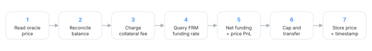

Settlement is how a market catches up with the world. Between interactions, the oracle price moves and the collateral vault earns whatever it earns, but none of that belongs to anyone in particular until settlement rewrites the split between the Receiver and Payer pools. Because settlement runs inside the deposit and redemption that triggered it, there is no keeper to wait for and no separate update transaction to send. The trade you make is always priced against a market that has first been brought up to date.

That design has a quiet consequence worth understanding. A market that nobody touches does not settle, however far the price travels in the meantime. The whole move, whether it takes a minute or a month, arrives in a single settlement for whoever interacts next, subject to the breaker described below. Read only previews through `NullV1Lens` follow the same path in simulation, so what a preview shows is what an actual deposit or redemption would do.

<Frame>
  
  
</Frame>

## First, agree on what the market holds

Settlement begins in `SettlementLib.prepareUpdate`, and it begins with the balance sheet rather than the price. The market reads `collateral.balanceOf(market)` and reconciles it against its booked split of Receiver assets, Payer assets, and protocol fees. If the real balance is higher, because the vault share price rose, because someone donated collateral, or for any other reason, the surplus is divided between the pools in proportion to their current sizes. If it is lower, the shortfall is taken from them the same way. When both pools are empty there is nothing to divide between, and any balance falls to protocol fees.

Only once the books match reality does the collateral fee step run. In principle it would skim an annualised fee from both pools into protocol fees at this point. In practice `MAX_COLLATERAL_FEE` is zero, so no market can be configured to charge it and the step is idle. It remains in the sequence because the accounting order matters if that ever changes, and because fees elsewhere in the system assume reconciliation has already happened.

With the state prepared, the market calls `frm.fundingRate` on that prepared state. The order is the point: the funding model sees pools that already reflect the collateral the market truly holds, and its answer can then be combined with the price movement that follows. The model for current markets is described in [Funding rate model](/protocol/funding-rate-model).

## Then, decide whether anything may move

`finalizeUpdate` guards everything that follows with a floor, `MIN_POOL_ASSETS`, set at `1e6` raw collateral units. If either pool sits at or below that floor, funding and price profit and loss are both skipped for this settlement. The market still records the new price and timestamp, but no value changes hands.

The floor exists for symmetry as much as for safety. A pool that cannot be debited below the floor must not be allowed to keep collecting from the other side either, or holding a nearly empty pool would become a free option on its counterparty. Below the floor, both directions close together.

## Price and funding, netted into one transfer

Above the floor, both price and funding are calculated on the same base, the settleable Receiver assets:

```text
settleableReceiver = receiverPool - MIN_POOL_ASSETS
```

Sizing everything from the settleable amount, rather than the whole pool, keeps entitlement and liability equal. A Receiver pool can earn on exactly what it could lose, no more.

Price profit and loss converts the oracle move into collateral. Oracle prices are scaled to `PRICE_SCALE`, or `1e36`, so the settleable assets are first expressed as a notional at the stored price, and the change in price is then applied to that notional. A rising price produces a transfer toward Receivers, a falling price the mirror image. Before that calculation is allowed to stand, it passes the [circuit breaker](/protocol/circuit-breaker): a move larger than 20 percent in this single settlement has its price leg skipped entirely, as explained below.

Funding is simpler arithmetic on the same base. For a rate returned by the model and an interval since the last settlement, the amount is:

```text
fundingAmount = settleableReceiver * |rate| / WAD * elapsed / 365 days
```

where `WAD` is `1e18`. A positive rate is owed by Receivers to Payers, so it reduces whatever the price leg would have paid Receivers, or adds to what they owe.

The two legs are never paid separately. They are summed into one signed transfer, and that transfer is capped at the settleable assets of whichever pool is paying, so settlement can reduce a pool to the floor but never through it. The market then stores the new oracle price and the current timestamp, whether or not the breaker fired, and the deposit or redemption that started all of this proceeds at the updated values. An `UpdateState` event reports the resulting balances, protocol fees, price, and whether the breaker fired, for indexers and interfaces that need to explain what just happened.

Through every step, one identity is preserved, and it is the quickest check that settlement has done its job:

```text
receiverPool + payerPool + protocolFees == collateral.balanceOf(market)
```

Settlement creates nothing and destroys nothing. It only decides, carefully and in a fixed order, whose collateral is whose.
